# KIẾN TRÚC HỆ SINH THÁI AI AGENT — CH ACADEMY

**Dự án:** CH Academy (`E:\CA_NHAN\CH_Academy`)  
**Tham chiếu:** Nexva Gen AI Chat Box (`E:\CACMONTRENLOP\nexva`)  
**Phiên bản kiến trúc:** 2.0 Native Enterprise AI

---

## 1. TỔNG QUAN KIẾN TRÚC HỆ THỐNG

Hệ sinh thái AI Agent tại CH Academy được thiết kế theo mô hình **Native Enterprise Spring Boot + React + PostgreSQL**, kết hợp tri thức động từ nghiệp vụ giáo dục và tri thức tĩnh từ Kho tài liệu (RAG - Retrieval Augmented Generation).

Khác với mô hình chạy Node.js / Python service độc lập làm phân mảnh quản trị và xác thực, CH Academy tích hợp toàn bộ AI Runtime trực tiếp vào lõi Spring Boot 3.3.4, kế thừa toàn diện Spring Security JWT, giao dịch ACID của PostgreSQL và phân quyền RBAC đa cổng.

```mermaid
flowchart TD
    subgraph ClientLayer["Lớp Kênh Người dùng (Omnichannel Clients)"]
        WebGuest["Website Khách vãng lai (Landing Page)"]
        StudentPortal["Cổng Học viên (/portal)"]
        TeacherPortal["Cổng Giảng viên (/teacher)"]
        AdminPortal["Cổng Quản trị (/admin)"]
        ZaloChannel["Zalo Official Account (OA Webhook)"]
        VoiceClient["AI Voice & Audio Interface"]
    end

    subgraph SecurityLayer["Lớp Bảo mật & Phân tách Danh tính (Security & Isolation)"]
        JWTFilter["JwtAuthenticationFilter & PortalValidator"]
        SessionTracker["Guest Session Manager (Public Rate-limit)"]
        RBAC["Phân quyền Role-Based (PUBLIC / STUDENT / TEACHER / ADMIN)"]
    end

    subgraph AIRuntime["Lớp AI Runtime & Điều phối (CH Academy AI Engine)"]
        AgentDispatcher["Agent Dispatcher (Router theo Cổng & Kênh)"]
        FlowEngine["Conversation Flow Engine (Dịch kịch bản theo Nexva)"]
        ContextInjector["Dynamic Context Injector (Tra cứu DB thời gian thực)"]
        RAGSearch["RAG Search Engine (Tìm kiếm phân đoạn tri thức Chunk)"]
        HandoffManager["Human Handoff Coordinator (Báo tư vấn viên)"]
        LLMAdapter["LLM Gateway Adapter (Gemini 2.5 Flash / OpenRouter)"]
    end

    subgraph StorageLayer["Lớp Cơ sở Dữ liệu & Lưu trữ (PostgreSQL 16)"]
        AgentDB[("ai_agents & ai_flows & ai_channel_configs")]
        KBDB[("ai_knowledge_bases & ai_kb_documents & ai_kb_chunks")]
        ChatDB[("ai_conversations & ai_messages & ai_leads")]
        BusinessDB[("classes, enrollments, exams, receivables, students, teachers")]
    end

    ClientLayer --> SecurityLayer
    SecurityLayer --> AIRuntime
    AIRuntime --> StorageLayer
```

---

## 2. 4 TRỤ CỘT AI AGENT CHUYÊN TRÁCH

| Mã Agent | Tên Agent | Cổng phục vụ | Model LLM | Nguồn tri thức chính |
| :--- | :--- | :--- | :--- | :--- |
| `AGENT_ADMISSIONS` | Chuyên viên Tư vấn Tuyển sinh | Website công khai (`PUBLIC`) | Gemini 2.5 Flash | `KB_ADMISSIONS` (Bảng giá, Khóa học, Ưu đãi) |
| `AGENT_STUDENT_TUTOR` | Trợ giảng AI Đồng hành | Cổng Học viên (`STUDENT`) | Gemini 2.5 Flash | `KB_ACADEMIC_RULES` + Lịch học, Học phí, Lớp học thực tế |
| `AGENT_TEACHER_ASSISTANT` | Trợ lý Giảng dạy & Soạn bài | Cổng Giảng viên (`TEACHER`) | Gemini 2.5 Flash | `KB_TEACHING_GUIDES` + Lớp phụ trách, Ngân hàng đề thi |
| `AGENT_ADMIN_ASSISTANT` | Trợ lý Quản trị & Vận hành | Cổng Quản trị (`ADMIN`) | Gemini 2.5 Flash | `KB_ADMIN_PROCEDURES` + Doanh thu, Nhân sự, Tổng quan trung tâm |

---

## 3. NGUYÊN TẮC BẢO MẬT & CHỐNG ẢO GIÁC (ANTI-HALLUCINATION)

1. **Không truy vấn dữ liệu vượt quyền**: Khách vãng lai và học viên không thể tiếp cận dữ liệu nhạy cảm hay thông tin tài chính của trung tâm.
2. **Không bịa đặt số liệu**: Mọi câu trả lời liên quan đến lịch thi, điểm số, học phí hoặc ca học đều phải dựa trên truy vấn thời gian thực từ PostgreSQL.
3. **Trích dẫn nguồn bắt buộc (Source Citations)**: Mọi thông tin tư vấn chính sách, nội quy hoặc bảng giá đều được gắn kèm đoạn trích dẫn và tên văn bản tương ứng.
4. **Phân tách không gian hội thoại (Identity Isolation)**: Hội thoại của cổng nào chỉ tồn tại và được phép truy cập trong phạm vi cổng đó.

