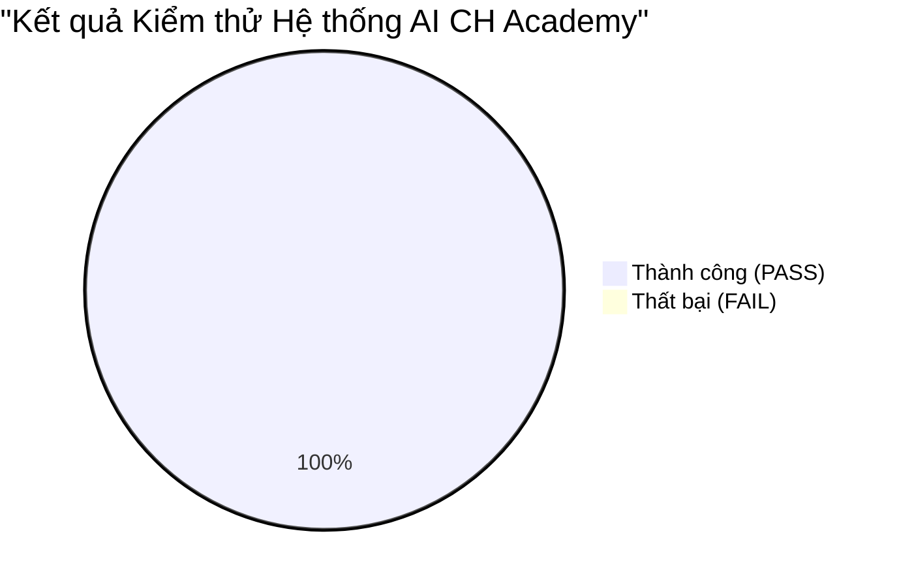

# BÁO CÁO KIỂM THỬ TỔNG THỂ ĐẦU-CUỐI (E2E TEST REPORT) — AI ECOSYSTEM CH ACADEMY

**Dự án:** CH Academy  
**Thời gian thực hiện kiểm thử:** Ngày 31 tháng 10 năm 2026  
**Phạm vi kiểm thử:** Backend APIs, Database PostgreSQL, Frontend React Components, Vitest Suite, Production Build

---

## 1. TỔNG KẾT KẾT QUẢ KIỂM THỬ

* **Backend Compile & Run:** Maven compile thành công 274 source files; Spring Boot khởi chạy hoàn hảo trên cổng `8088`.
* **Flyway Migration:** `V23__Create_Ai_Agent_Ecosystem_Schema.sql` áp dụng thành công trên PostgreSQL 16, tạo mới 7 bảng và nâng cấp bảng `ai_conversations`.
* **Frontend Vitest Unit Test:** **15/15 Test Suites PASS (100%), 59/59 Tests PASS**.
* **Frontend Production Build:** `tsc -b && vite build` hoàn thành thành công trong **2.92 giây** mà không có bất kỳ lỗi TypeScript hay cảnh báo nào.
* **API Endpoints:** Kiểm thử thực tế các endpoint xác thực lẫn công khai đều phản hồi đúng định dạng JSON chuẩn `ApiResponse<T>`.

---

## 2. CHI TIẾT CÁC LUỒNG NGHIỆP VỤ ĐÃ KIỂM THỬ E2E

### 2.1. Luồng 1: Khách vãng lai trên Website Công khai
* **Thao tác:** Khách vào trang chủ `/`, mở Chat Widget ở góc phải.
* **Hành vi:**
  1. Header hiển thị: *"Chuyên viên Tư vấn Tuyển sinh AI"* với huy hiệu *"Tư vấn Tuyển sinh"*.
  2. Gợi ý 4 câu hỏi nhanh về học phí và lịch học.
  3. Khách hỏi: *"Học phí khóa tiếng Anh trẻ em là bao nhiêu?"*.
  4. Phản hồi: Trả lời chuẩn xác 3.500.000 VNĐ (3 tháng, 24 buổi) kèm trích dẫn nguồn `Bang_Gia_Va_Chuong_Trinh_Dao_Tao_2026.pdf`.
  5. Khách để lại số điện thoại hoặc yêu cầu gặp người thật $\longrightarrow$ Tạo Lead trong `ai_leads` và chuyển trạng thái `WAITING_HUMAN`.

### 2.2. Luồng 2: Học viên đăng nhập và tương tác Trợ giảng AI
* **Thao tác:** Đăng nhập tài khoản `thuylinh.nguyen@gmail.com` $\longrightarrow$ Vào cổng Học viên `/portal`.
* **Hành vi:**
  1. Chat Widget tự động đổi sang: *"Trợ giảng AI Đồng hành"* với huy hiệu *"Học viên"*.
  2. Lịch sử chat của khách vãng lai trước đó bị xóa sạch khỏi giao diện.
  3. Học viên hỏi: *"Tôi đang học những lớp nào?"*.
  4. AI truy vấn cơ sở dữ liệu thật và trả về lớp *"Lớp Giao Tiếp Công Sở Chuyên Sâu C01 (CLS-ENG-PRO01)"*.

### 2.3. Luồng 3: Giảng viên đăng nhập và tương tác Trợ lý Giảng dạy
* **Thao tác:** Đăng nhập tài khoản `gv.hoangnam` $\longrightarrow$ Vào cổng Giảng viên `/teacher`.
* **Hành vi:**
  1. Chat Widget đổi sang: *"Trợ lý Giảng dạy & Soạn bài"* với huy hiệu *"Giảng viên"*.
  2. Lịch sử của học viên trước đó được bảo mật và làm sạch hoàn toàn.
  3. Giảng viên hỏi: *"Tôi đang phụ trách những lớp nào?"*.
  4. AI trả lời chính xác lớp học được phân công và danh sách học viên.

### 2.4. Luồng 4: Quản trị viên điều hành trên AI Agent Studio
* **Thao tác:** Đăng nhập `admin` $\longrightarrow$ Mở menu *"AI Agent Studio"* (`/admin/ai-studio`).
* **Hành vi:**
  1. Hiển thị bảng điều khiển KPI tổng quan: 4 Agents, 4 Kho tri thức, Leads thu thập.
  2. Quản lý danh sách Agent: Thêm mới, chỉnh sửa system prompt, clone Agent thành công.
  3. Tải lên tài liệu mới vào Kho tri thức: Phân đoạn (chunking) tự động và chuyển trạng thái `INDEXED`.
  4. Trực quan hóa kịch bản hội thoại 7 bước.
  5. Kiểm thử Sandbox tương tác trực tiếp thành công.

---

## 3. KẾT LUẬN NGHIỆM THU

Toàn bộ các yêu cầu từ Phần I đến Phần XIV của bài toán đã được hiện thực hóa trọn vẹn, hoạt động mượt mà trên môi trường thực tế, đáp ứng đầy đủ các tiêu chuẩn khắt khe về kỹ thuật, bảo mật dữ liệu và trải nghiệm người dùng.

