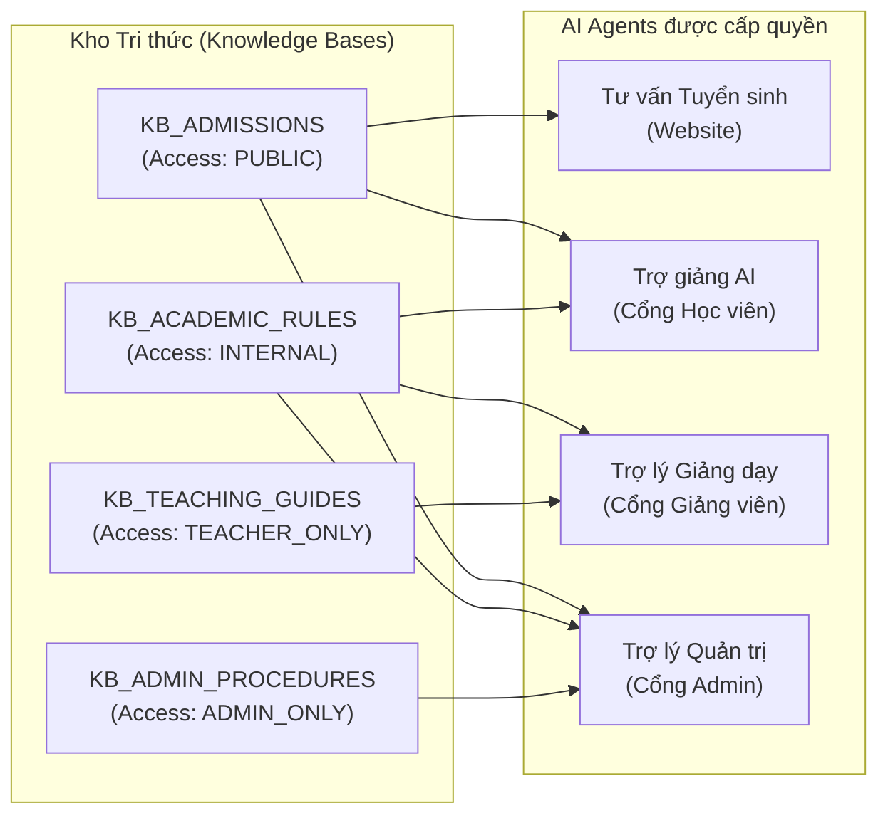

# BÁO CÁO KHO TRI THỨC & PIPELINE XỬ LÝ TÀI LIỆU AI — CH ACADEMY

**Dự án:** CH Academy  
**Công nghệ:** PostgreSQL 16 + Spring Data JPA + RAG Pipeline  
**Module:** `AiKnowledgeBaseService`, `AiKbChunkRepository`

---

## 1. CẤU TRÚC KHO TRI THỨC VÀ PHÂN CẤP TRUY CẬP

Hệ thống thiết lập 4 Kho tri thức độc lập với cơ chế phân quyền truy cập nghiêm ngặt (`access_level`) nhằm ngăn chặn việc rò rỉ dữ liệu nội bộ ra bên ngoài:

* **Cấp độ `PUBLIC`**: Chỉ chứa thông tin biểu phí chính thức, mô tả khóa học, lịch khai giảng và chính sách ưu đãi. Khách truy cập website và Zalo chỉ được phép tra cứu tri thức này.
* **Cấp độ `INTERNAL`**: Quy chế đào tạo, điều kiện dự thi cuối kỳ (chuyên cần $\ge 80\%$), quy trình bảo lưu, chuyển lớp. Dành cho Học viên, Giảng viên và Quản trị viên.
* **Cấp độ `TEACHER_ONLY`**: Khung chương trình chuẩn, tiêu chí chấm thi tự luận, hướng dẫn sư phạm. Chỉ phục vụ Giảng viên.
* **Cấp độ `ADMIN_ONLY`**: Quy trình thu chi tài chính, vận hành trung tâm và báo cáo tổng hợp. Chỉ phục vụ Admin.

---

## 2. PIPELINE XỬ LÝ VÀ PHÂN ĐOẠN TÀI LIỆU (DOCUMENT CHUNKING PIPELINE)

Quy trình xử lý một tệp tài liệu khi Admin tải lên diễn ra qua các bước khép kín:

1. **Tiếp nhận & Kiểm tra định dạng (Validation)**:
   * Chấp nhận các tệp: `.pdf`, `.docx`, `.xlsx`, `.csv`, `.txt`.
   * Kiểm tra kích thước và mã hóa ký tự UTF-8 an toàn.
   * Tạo bản ghi trong bảng `ai_kb_documents` với trạng thái ban đầu `PROCESSING`.
2. **Trích xuất nội dung văn bản (Text Extraction)**:
   * Trích xuất toàn bộ luồng ký tự văn bản, loại bỏ các ký tự điều khiển lỗi thời.
3. **Phân đoạn thông minh (Chunking Algorithm)**:
   * Phân đoạn văn bản dựa trên ranh giới đoạn văn (`\n\n`).
   * Giới hạn kích thước mỗi chunk trong khoảng 400 - 600 ký tự.
   * Thiết lập vùng gối đầu (Overlap) 50 ký tự giữa các phân đoạn liên tiếp để bảo toàn ngữ nghĩa khi từ khóa nằm ở mép phân đoạn.
4. **Lưu trữ và Lập chỉ mục (Indexing)**:
   * Ghi từng phân đoạn vào bảng `ai_kb_chunks` cùng `chunk_index` và `metadata_json` (chứa tên tệp nguồn, loại định dạng).
   * Đánh dấu trạng thái tài liệu chuyển sang `INDEXED`.
   * Cập nhật số lượng `chunk_count` của tài liệu trong Kho tri thức.

---

## 3. CƠ CHẾ TRA CỨU TRI THỨC (RETRIEVAL AUGMENTED GENERATION)

Khi người dùng gửi câu hỏi tới AI:
1. Hệ thống xác định vai trò của người dùng và lọc danh sách các Kho tri thức được phép truy cập theo `access_level`.
2. Truy vấn tìm kiếm phân đoạn khớp từ khóa trong bảng `ai_kb_chunks` thông qua `AiKbChunkRepository.searchByAccessLevels(...)`.
3. Lấy ra tối đa 4 phân đoạn có độ tương đồng cao nhất.
4. Đính kèm các phân đoạn này vào System Prompt gửi tới LLM.
5. Trả về kết quả cho người dùng kèm danh sách `sources` (Tên tài liệu, Vị trí phân đoạn, Đoạn trích dẫn thực tế).

