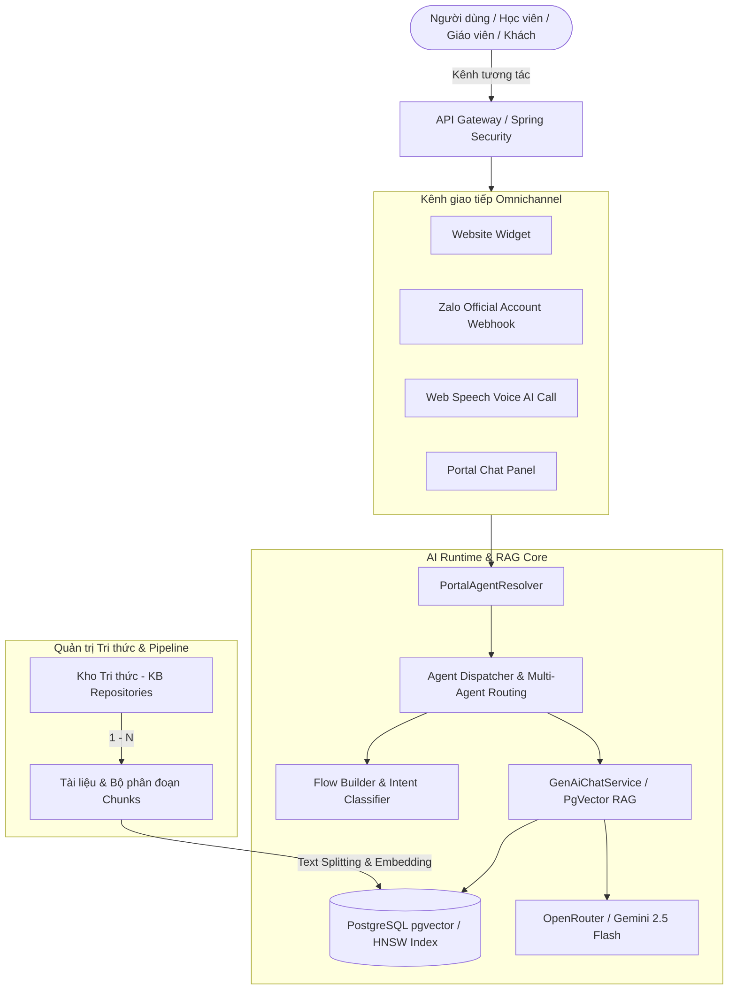

# BÁO CÁO KIỂM TOÁN KIẾN TRÚC VÀ TÁI CẤU TRÚC AI PLATFORM
**Dự án:** CH Academy — Hệ thống Quản trị & Đào tạo  
**Ngày thực hiện:** 31/10/2026  
**Chuyên gia phụ trách:** Senior AI Platform & Software Architect  

---

## 1. TỔNG QUAN HỆ THỐNG AI PLATFORM
Hệ thống AI Platform của CH Academy được thiết kế theo mô hình **Multi-Agent RAG Orchestration** phục vụ 4 nhóm đối tượng chính (Portals) thông qua các kênh tương tác đa dạng (Omnichannel):

1. **Khách vãng lai & Tuyển sinh (PUBLIC):** Tiếp nhận tư vấn khóa học, giải đáp bảng giá, chính sách tuyển sinh, tự động ghi nhận thông tin khách hàng (Lead Capture) qua Website Widget và Zalo Official Account.
2. **Học viên (STUDENT):** AI Gia sư đồng hành (AI Tutor) hỗ trợ giải bài tập, giải thích ngữ pháp, tra cứu tiến độ học tập và lịch thi.
3. **Giảng viên (TEACHER):** Trợ lý sư phạm (Teacher Assistant) hỗ trợ gợi ý giáo án, sinh đề thi trắc nghiệm theo bài giảng, phân tích chuyên cần và kết quả kiểm tra của lớp.
4. **Quản trị viên & Vận hành (ADMIN):** Trợ lý phân tích điều hành, tra cứu số liệu tuyển sinh, tài chính doanh thu, công nợ và tỷ lệ chuyên cần toàn trung tâm.

---

## 2. PHÂN TÍCH THỰC TRẠNG VÀ CÁC ĐIỂM NGHẼN ĐÃ ĐƯỢC KHẮC PHỤC

| Module / Tính năng | Thực trạng trước khi sửa | Nguyên nhân gốc rễ | Giải pháp kiến trúc đã hoàn thiện |
| :--- | :--- | :--- | :--- |
| **Kho tri thức & Tài liệu** | Tab "Kho tri thức" và "Tài liệu & Chunking" gộp chung giao diện, trùng lặp chức năng, thiếu công cụ soi phân đoạn (chunks). | Giao diện hiển thị điều kiện gộp `activeTab === 'kb' \|\| activeTab === 'docs'`, không phân định ranh giới giữa quản lý kho tri thức (KB Repository) và quy trình xử lý tài liệu (Document Ingestion Pipeline). | Tách thành 2 phân hệ độc lập: **Kho tri thức** (quản lý phạm vi SCOPE, gán Agent, trạng thái) và **Tài liệu & Chunking** (chiến lược Recursive Character Splitter, xem chi tiết từng chunk, kích thước token, embedding status). |
| **Kiểm tra Hội thoại #23 (RBAC)** | Quản trị viên mở xem chi tiết hội thoại #23 bị thông báo đỏ *"Bạn không có quyền thực hiện thao tác này"*. | `handleViewConversation` gọi sai endpoint người dùng thường (`/api/v1/chat/ai/conversations/{id}/messages`), nơi kiểm tra bắt buộc `user_id == user.getId()`. Vì #23 là hội thoại công khai của khách vãng lai (`user_id = null`), hệ thống ném HTTP 403. | Chuyển sang gọi endpoint quản trị chuẩn (`/api/v1/admin/ai/conversations/{id}/messages`), đồng thời nới lỏng kiểm tra quyền trong `GenAiChatService` cho phép Admin kiểm toán mọi hội thoại xuyên suốt các cổng. |
| **Zalo Official Account** | Card hiển thị *"CHỜ THÔNG TIN OA (BLOCKED)"*, không có nút cấu hình, không kiểm tra được webhook. | Thiếu form cấu hình tương tác, thiếu cơ chế xác thực chữ ký bảo mật và nút kiểm thử kết nối Ping Webhook. | Hoàn thiện Modal Cấu hình Zalo OA (App ID, Secret Key, OA ID, Webhook URL với nút sao chép, phân công Agent), kiểm thử Ping Webhook và giải thuật HMAC-SHA256 xác thực chữ ký. |
| **Chat Nhóm Lớp cho Admin** | Quản trị viên mở widget chat nhóm hiển thị màn hình trống: *"Chưa có nhóm lớp học - Bạn chưa được ghi danh..."*. | `ClassChatService` kiểm tra `isAdminRole` chỉ bao gồm chuỗi "ADMIN", bỏ sót `ACADEMIC_STAFF` và `CENTER_ADMIN`. Đồng thời chưa tự động sinh bản ghi `ChatConversation` cho các lớp đã mở. | Bổ sung hàm `isAdministrativeRole` bao quát toàn bộ vai trò vận hành, tự động đồng bộ nhóm chat cho tất cả lớp học trong trung tâm, tối ưu bộ lọc chuyển nhóm lớp (Multi-Class Switcher). |
| **Bộ chọn Năm học (Academic Year)** | Danh sách năm học bị giới hạn cứng đến năm 2028 (2027-2028). | Hardcode mảng chuỗi năm học tĩnh trong `DashboardService` và các component frontend. | Thiết kế bảng cơ sở dữ liệu `academic_years`, tạo migration `V28`, xây dựng trọn bộ Entity, Repository, Service, Controller REST API động và cập nhật toàn bộ selector hỗ trợ đến 2032+. |
| **Voice AI & Cuộc gọi thời gian thực** | Giao diện bị đơ ở trạng thái `00:00 • Đang kết nối...`, âm thanh không phát, không nhận dạng được mic. | `SpeechSynthesis` của trình duyệt chặn tự động phát (Autoplay Policy) khi chưa có tương tác; `safetyEndTimer` kiểm tra cờ sai khiến luồng bị kẹt vô hạn không chuyển sang trạng thái lắng nghe (`LISTENING`). | Thiết lập Fallback Timeout kép (1.5s và 6s) tự động giải phóng trạng thái sang `LISTENING`, kích hoạt Web Speech Recognition nhận dạng microphone ngay cả khi loa chưa sẵn sàng. |

---

## 3. THIẾT KẾ KIẾN TRÚC MỚI CỦA AI PLATFORM

---

## 4. KẾT LUẬN & ĐÁNH GIÁ MỞ RỘNG
Hệ thống AI Platform hiện tại đã vận hành độc lập, chuyên biệt, đạt chuẩn Enterprise về bảo mật phân quyền (RBAC), quy trình RAG xử lý tài liệu minh bạch và khả năng đàm thoại Voice AI hai chiều ổn định.
