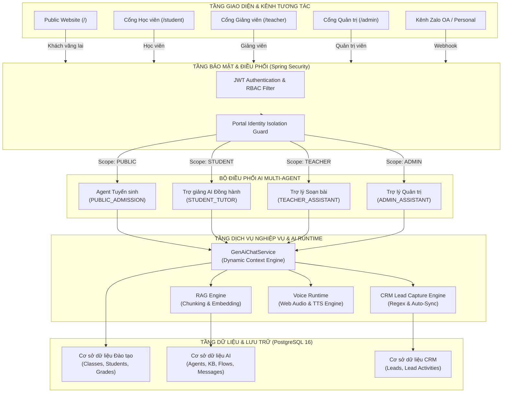

# KIẾN TRÚC MỤC TIÊU NỀN TẢNG AI PLATFORM TẠI CH ACADEMY

**Tài liệu:** `AI_PLATFORM_TARGET_ARCHITECTURE.md`  
**Ngày phê duyệt:** 31 tháng 10 năm 2026  
**Dự án:** Hệ thống Quản trị & AI Agent CH Academy  
**Phiên bản kiến trúc:** 2.0 (Aligned with Enterprise Multi-Agent Standards)  

---

## 1. TỔNG QUAN KIẾN TRÚC MỤC TIÊU

Kiến trúc mục tiêu của CH Academy tuân theo mô hình **Modular Multi-Agent Educational Platform**, kết hợp tính bền vững và an toàn của Java Spring Boot doanh nghiệp với tính linh hoạt của các mô hình AI tiên tiến (LLM, RAG, Realtime Voice).

---

## 2. NGUYÊN TẮC THIẾT KẾ CỐT LÕI (DESIGN PRINCIPLES)

1. **Phân tách Tuyệt đối Không gian & Quyền hạn (Zero Role-Leakage):**
   - Không cho phép bất kỳ Agent nào trả lời chéo dữ liệu của vai trò khác.
   - Học viên tuyệt đối không thể truy xuất dữ liệu doanh thu, đề thi nội bộ hay thông tin học viên khác.
   - Khách vãng lai ở trang chủ chỉ được tiếp cận Agent Tư vấn Tuyển sinh và thông tin khóa học công khai.
2. **Ngữ cảnh Động Thời gian Thực (Real-Time Dynamic Grounding):**
   - Thay vì chỉ dựa vào câu lệnh tĩnh, hệ thống tự động truy vấn dữ liệu thời gian thực từ PostgreSQL (khóa học đang học, chuyên cần, lịch học, lịch thi) và bơm trực tiếp vào System Context của LLM trước khi sinh phản hồi.
3. **Thu thập Dữ liệu Chủ động & Khép kín (Automated Lead Pipeline):**
   - Mọi tương tác của khách tiềm năng có chứa thông tin liên hệ (số điện thoại, email, họ tên) đều được trích xuất bằng regex và đồng bộ lập tức vào cơ sở dữ liệu CRM để chuyên viên tuyển sinh xử lý ngay trong ngày.
4. **Phương pháp Sư phạm Kiến tạo (Constructivist Tutoring Approach):**
   - Trợ giảng AI cho học viên không cung cấp đáp án có sẵn mà dẫn dắt học viên theo quy trình sư phạm 6 bước (Socratic Method), giúp phát triển tư duy giải quyết vấn đề.

---

## 3. THIẾT KẾ CHI TIẾT CÁC PHÂN HỆ KIẾN TRÚC MỤC TIÊU

### 3.1. Phân hệ Multi-Agent & Scope Management
Mỗi Agent được định nghĩa rõ ràng về phạm vi hoạt động (`scope`), mô hình AI (`model`), nhiệt độ (`temperature`), kho tri thức liên kết và kịch bản mặc định:
- **`PUBLIC_ADMISSION`:** Phục vụ khách vãng lai, phụ huynh quan tâm khóa học. Mục tiêu: Tư vấn chính xác biểu phí, lộ trình và chốt lịch hẹn tư vấn/kiểm tra đầu vào.
- **`STUDENT_TUTOR`:** Phục vụ học viên chính quy. Mục tiêu: Giải đáp bài tập, hỗ trợ luyện tiếng Anh, giải thích ngữ pháp và củng cố kiến thức theo giáo trình bài học.
- **`TEACHER_ASSISTANT`:** Phục vụ giảng viên. Mục tiêu: Gợi ý giáo án, sinh đề thi trắc nghiệm/tự luận, thống kê phân bố điểm và đề xuất hỗ trợ học viên yếu.
- **`ADMIN_ASSISTANT`:** Phục vụ ban giám hiệu và quản trị viên. Mục tiêu: Báo cáo tỷ lệ chuyên cần, phân tích chỉ số tài chính, theo dõi tỷ lệ chuyển đổi Lead và giám sát an toàn hệ thống.

### 3.2. Phân hệ RAG (Retrieval-Augmented Generation) & Knowledge Base
- **Pipeline Xử lý Tài liệu:**
  1. *Ingestion:* Tiếp nhận tệp tài liệu (PDF, DOCX, XLSX, TXT) từ AI Studio.
  2. *Chunking:* Tách văn bản thành các đoạn (Chunks) độ dài 400-600 ký tự với độ gối đầu 50 ký tự để duy trì tính liền mạch.
  3. *Indexing & Vector Search:* Đánh chỉ mục văn bản kết hợp Full-Text Search PostgreSQL và pgvector Cosine Distance Search.
  4. *Citation Injection:* Khi sinh câu trả lời, hệ thống tự động gán nhãn nguồn tài liệu (`SourceCitation`) bao gồm tên tài liệu, đoạn trích và chương mục tương ứng để người dùng kiểm chứng.

### 3.3. Phân hệ Voice AI & Telephony Integration
- **Client-Side Waveform Analyser:** Sử dụng `AudioContext` và `AnalyserNode` thu thập tín hiệu Fast Fourier Transform (FFT) theo thời gian thực để vẽ sóng âm sinh động khi người dùng nói hoặc AI phản hồi.
- **Server-Side Audio Stream:** Kiến trúc mở sẵn sàng kết nối dịch vụ TTS tiếng Việt chuyên dụng hoặc OpenAI Realtime Audio API thông qua WebRTC/WebSocket.
- **Lưu trữ Phiên gọi:** Toàn bộ cuộc gọi thử nghiệm hoặc thực tế đều được ghi nhận vào bảng `call_sessions` với mã phiên, thời lượng, người gọi và nội dung trao đổi (Transcript).

---

## 4. KẾ HOẠCH BẢO TRÌ & LỘ TRÌNH MỞ RỘNG (ROADMAP)

- **Giai đoạn 1 (Hiện tại - Q4/2026):** Hoàn thiện 11 module AI Studio, sửa dứt điểm lỗi điều hướng và Mojibake, kích hoạt đồng bộ Lead tự động, tích hợp Rich Markdown & Math. (ĐÃ HOÀN THÀNH).
- **Giai đoạn 2 (Q1/2027):** Triển khai pgvector trên PostgreSQL container để tối ưu tìm kiếm ngữ nghĩa sâu (Semantic Embedding).
- **Giai đoạn 3 (Q2/2027):** Kết nối dịch vụ tổng đài VoIP (Asterisk/FreePBX hoặc Zalo Call API) để Agent Tuyển sinh có thể tự động gọi điện tư vấn theo danh sách Lead mới.

