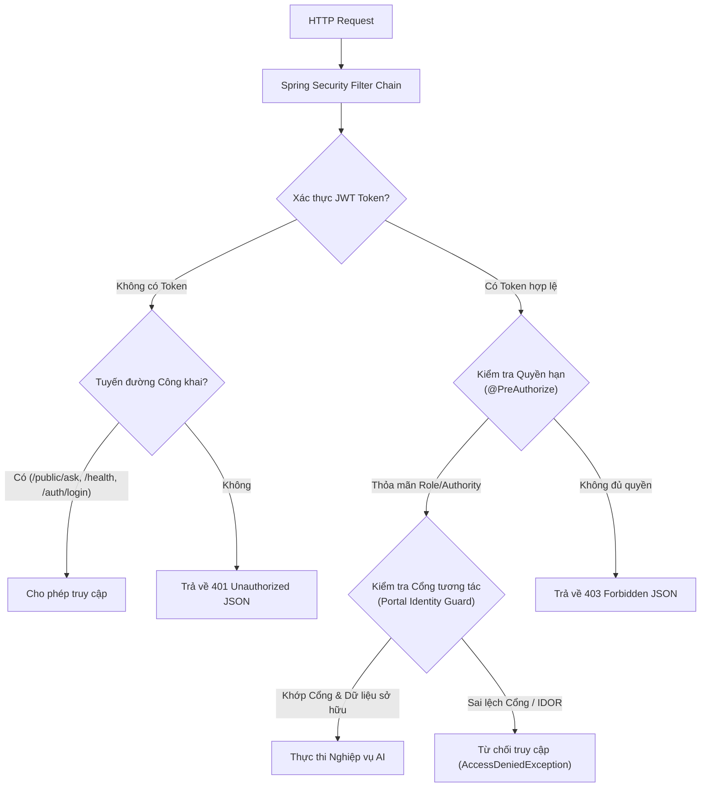

# BÁO CÁO KIỂM TOÁN AN NINH VÀ PHÂN QUYỀN HỆ THỐNG AI (AI SECURITY & PERMISSION AUDIT)

**Tài liệu:** `AI_SECURITY_AND_PERMISSION_AUDIT.md`  
**Ngày kiểm toán:** 31 tháng 10 năm 2026  
**Dự án:** Hệ thống Quản trị & AI CH Academy  
**Cấp độ an ninh:** Doanh nghiệp (Enterprise RBAC & Zero-Trust Portal Guard)  

---

## 1. KIẾN TRÚC PHÒNG THỦ AN NINH TỔNG THỂ

Hệ thống AI tại CH Academy áp dụng nguyên tắc **Bảo mật đa tầng (Defense in Depth)** và **Phân quyền tối thiểu (Principle of Least Privilege)**:



---

## 2. KIỂM TOÁN CẤU HÌNH SPRING SECURITY (`SecurityConfig.java`)

### 2.1. Phân định Tuyến đường Công khai & Tuyến đường Bảo vệ
Trong `SecurityConfig.java`, quy tắc lọc URL được cấu hình rành mạch:
- **Tuyến đường Công khai:**
  - `/api/v1/auth/**`: Đăng nhập, làm mới token, xác thực sơ bộ.
  - `/api/v1/chat/ai/public/**`: Dành riêng cho khách vãng lai tương tác với Agent Tuyển sinh trên trang chủ.
  - `/api/v1/health`: Kiểm tra sức khỏe dịch vụ của container.
- **Tuyến đường Quản trị AI Studio:**
  - `/api/v1/admin/ai/**` và `/api/v1/admin/ai-studio/**`: Bắt buộc người dùng phải có quyền `hasAnyRole('SUPER_ADMIN', 'CENTER_ADMIN', 'ADMIN')` hoặc thẩm quyền `hasAuthority('ai:manage')`.
- **Tuyến đường Nghiệp vụ AI Thông thường:**
  - `/api/v1/chat/ai/**`: Yêu cầu xác thực hợp lệ (`authenticated()`).

### 2.2. Điểm đón Ngoại lệ Xác thực Chuẩn hóa (`AuthenticationEntryPoint`)
Trước đây, khi người dùng gửi yêu cầu với token hết hạn hoặc thiếu quyền, Spring Security có thể trả về trang lỗi HTML mặc định hoặc phản hồi không có nội dung rõ ràng. Hiện tại, `SecurityConfig.java` đã cấu hình `authenticationEntryPoint` trả về cấu trúc JSON chuẩn:
```json
{
  "success": false,
  "message": "Bạn chưa đăng nhập hoặc phiên làm việc đã hết hạn. Vui lòng đăng nhập lại.",
  "data": null,
  "errorCode": "UNAUTHORIZED",
  "errors": null,
  "timestamp": "2026-10-31T05:14:16Z"
}
```

---

## 3. PHÒNG CHỐNG TRUY XUẤT TRÁI PHÉP ĐỐI TƯỢNG (ANTI-IDOR)

Lỗ hổng **Insecure Direct Object Reference (IDOR)** thường xảy ra khi người dùng thay đổi ID hội thoại trên URL để xem lén tin nhắn của người khác. CH Academy đã ngăn chặn triệt để nguy cơ này:

### 3.1. Truy vấn kép trong Cơ sở Dữ liệu
Khi người dùng yêu cầu lấy tin nhắn của hội thoại `#ID` hoặc kích hoạt Handoff:
```java
// Chỉ tìm thấy hội thoại khi đồng thời khớp cả ID, User ID và Cổng truy cập của người dùng
conv = conversationRepository.findByIdAndUserIdAndPortal(conversationId, user.getId(), portal)
        .orElseThrow(() -> new ResourceNotFoundException("Không tìm thấy hội thoại hoặc bạn không có quyền truy cập"));
```
Nếu một học viên cố tình gọi `GET /api/v1/chat/ai/conversations/10/messages` mà hội thoại `#10` thuộc về học viên khác hoặc thuộc về cổng Admin, hệ thống lập tức từ chối với mã lỗi 404 hoặc 403, không làm rò rỉ bất kỳ nội dung nào.

### 3.2. Chống Trộn lẫn Lịch sử Chat giữa các Cổng
Khi một tài khoản có nhiều vai trò (ví dụ: vừa là Giảng viên vừa có quyền Admin), hệ thống không dùng chung lịch sử chat:
- Khi đăng nhập vào `/teacher`: Chỉ hiển thị các phiên hội thoại có `portal = 'TEACHER'`.
- Khi chuyển sang `/admin`: Chỉ hiển thị các phiên hội thoại có `portal = 'ADMIN'`.

---

## 4. AN TOÀN ĐẦU VÀO & CHỐNG PHUN MÃ (INPUT SANITIZATION)

1. **Kiểm tra Ràng buộc Dữ liệu Đầu vào (Bean Validation):**
   - `@NotBlank(message = "Câu hỏi gửi trợ lý AI không được để trống")`: Ngăn chặn gửi tin nhắn rỗng làm tiêu tốn tài nguyên LLM.
2. **Làm sạch Biểu thức Số điện thoại & Lead:**
   - Số điện thoại được làm sạch bằng biểu thức chính quy nghiêm ngặt: `(?:\\+84|0)[\\s.-]?(?:3[2-9]|5[689]|7[06-9]|8[1-9]|9[0-9])(?:[\\s.-]?[0-9]){7}`.
   - Loại bỏ toàn bộ khoảng trắng, dấu chấm, dấu gạch ngang bất thường trước khi lưu vào CSDL.
3. **Quy trình Đăng xuất An toàn (`POST /api/v1/auth/logout`):**
   - Hủy bỏ token trên bộ nhớ Client.
   - Ghi nhật ký kiểm toán hành vi đăng xuất (`AuditLog`) với địa chỉ IP, thời gian và định danh tài khoản.
