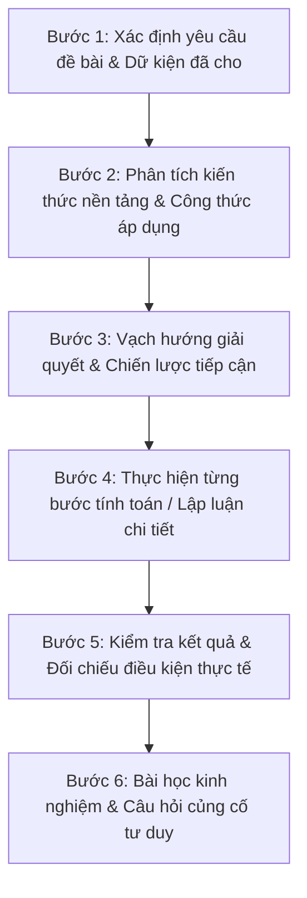

# LỘ TRÌNH VÀ PHƯƠNG PHÁP SƯ PHẠM TRỢ GIẢNG AI ĐỒNG HÀNH (AI TUTOR ROADMAP)

**Tài liệu:** `AI_TUTOR_ROADMAP.md`  
**Ngày cập nhật:** 31 tháng 10 năm 2026  
**Dự án:** Trợ giảng AI Cổng Học viên (`/student`) — CH Academy  
**Phiên bản Sư phạm:** 2.0 (Socratic Constructivist Framework)  

---

## 1. MỤC TIÊU SƯ PHẠM CỦA TRỢ GIẢNG AI

Khác biệt với các Chatbot thông thường chỉ đơn thuần đưa ra đáp án cuối cùng, **Trợ giảng AI Đồng hành (`AGENT_STUDENT_TUTOR`)** tại CH Academy được xây dựng theo triết lý **Sư phạm Kiến tạo (Constructivism)** và **Phương pháp gợi mở Socrates (Socratic Method)**:
- Không làm bài tập thay cho học sinh.
- Không giải tắt để học sinh chép đối phó.
- Dẫn dắt học sinh tự tư duy, hiểu rõ bản chất vấn đề và xây dựng phương pháp tự học lâu dài.

---

## 2. QUY TRÌNH HƯỚNG DẪN 6 BƯỚC SƯ PHẠM (6-STEP METHODOLOGY)

Khi học sinh đặt câu hỏi hoặc gửi bài tập yêu cầu trợ giúp, Trợ giảng AI sẽ áp dụng quy trình chuẩn 6 bước:

### Chi tiết nội dung từng bước:
1. **Bước 1 — Xác định yêu cầu đề bài & Dữ kiện đã cho:**
   - Tóm tắt đề bài ngắn gọn, phân tách rõ ràng cái đã biết (giả thiết) và cái cần tìm (kết luận).
2. **Bước 2 — Phân tích kiến thức nền tảng & Công thức áp dụng:**
   - Nhắc lại định lý, định luật, cấu trúc ngữ pháp hoặc công thức toán học cần sử dụng.
3. **Bước 3 — Vạch hướng giải quyết & Chiến lược tiếp cận:**
   - Giải thích tại sao chọn hướng tiếp cận này thay vì cách khác, gợi mở các nhánh tư duy.
4. **Bước 4 — Thực hiện từng bước tính toán / Lập luận chi tiết:**
   - Trình bày mạch lạc từng phép tính, từng dòng biến đổi toán học hoặc phân tích câu.
5. **Bước 5 — Kiểm tra kết quả & Đối chiếu điều kiện thực tế:**
   - Kiểm tra đơn vị đo, điều kiện xác định, tính hợp lý của kết quả số học trong thực tế.
6. **Bước 6 — Bài học kinh nghiệm & Câu hỏi củng cố tư duy:**
   - Đúc kết sai lầm học sinh hay mắc phải và đưa ra 1 câu hỏi tương tự để học sinh tự luyện tập.

---

## 3. CÔNG NGHỆ HIỂN THỊ TOÁN HỌC & ĐỊNH DẠNG NỘI DUNG

Để hỗ trợ học sinh học tập môn Toán, Khoa học tự nhiên và Lập trình một cách trực quan, hệ thống đã phát triển thành phần **`RichMarkdownRenderer.tsx`** với các năng lực:

### 3.1. Biên dịch công thức Toán học chuẩn LaTeX
Hệ thống tự động nhận diện các ký hiệu toán học phổ biến và chuyển đổi thành giao diện KaTeX/Unicode chuyên nghiệp:
- Phân số: `\frac{a}{b}` -> dạng số trên số dưới có gạch ngang đẹp mắt.
- Căn thức: `\sqrt{x}`, `\sqrt[n]{x}`.
- Lũy thừa và chỉ số dưới: `x^2`, `a_n`, `x_{i+1}`.
- Các ký tự đặc biệt: `\pm` ($\pm$), `\times` ($\times$), `\div` ($\div$), `\alpha`, `\beta`, `\Delta`, `\sum`, `\int`, `\infty`.

### 3.2. Huy hiệu Sư phạm Trực quan (Step Badge Pills)
Khi câu trả lời có chứa các cụm từ "Bước 1", "Bước 2", "Bước 3"..., bộ hiển thị tự động bọc thành các huy hiệu pill màu xanh dương hiện đại (`px-2 py-0.5 rounded-full bg-blue-100 text-blue-700 font-semibold`), giúp học sinh dễ dàng theo dõi từng giai đoạn của bài học.

### 3.3. Khối mã nguồn & Bảng biểu
- Khối code (Python, JavaScript, SQL) được đóng khung nền tối với cú pháp nổi bật và nút **"Sao chép mã"** một chạm.
- Bảng biểu được kẻ ô rõ ràng với hàng so le màu giúp phân tích dữ liệu dễ nhìn.

---

## 4. BỘ ĐIỀU KHIỂN CHẾ ĐỘ SƯ PHẠM TRÊN GIAO DIỆN HỌC VIÊN

Trên giao diện Chat AI của Cổng Học viên (`FloatingChatWidget.tsx`), học sinh có thể chủ động chuyển đổi giữa 2 chế độ học tập thông qua thanh công tắc (Toggle Mode):
1. **Chế độ Hướng dẫn từng bước (6 bước):** Thích hợp khi đang học bài mới, giải bài tập về nhà hoặc chuẩn bị cho kỳ thi. AI sẽ kiên nhẫn đi qua từng bước sư phạm.
2. **Chế độ Giải thích chi tiết:** Thích hợp khi cần tra cứu nhanh khái niệm, tóm tắt bài giảng hoặc giải nghĩa một thuật ngữ chuyên ngành.

Ngoài ra, học sinh được cung cấp sẵn các thẻ gợi ý câu hỏi thông minh (Suggestion Pills):
- `📐 Hướng dẫn giải bài tập theo 6 bước sư phạm`
- `✍️ Sửa lỗi phát âm & ngữ pháp tiếng Anh`
- `📝 Tóm tắt kiến thức bài học vừa qua`
- `🎯 Tạo 3 câu hỏi trắc nghiệm tự luyện`

---

## 5. LỘ TRÌNH PHÁT TRIỂN TIẾP THEO

- **Giai đoạn 1 (Hiện tại):** Tích hợp công thức Toán học, 6 bước sư phạm và toggle chế độ học tập. *(Đã hoàn thành)*.
- **Giai đoạn 2 (Q1/2027):** Kết nối trực tiếp với điểm số và bài thi của học sinh trên hệ thống CH Academy, tự động đề xuất lộ trình ôn tập cá nhân hóa (Adaptive Learning).
- **Giai đoạn 3 (Q2/2027):** Trợ giảng chấm bài luận tiếng Anh theo tiêu chí IELTS 4 kỹ năng (Task Achievement, Coherence & Cohesion, Lexical Resource, Grammatical Accuracy).
