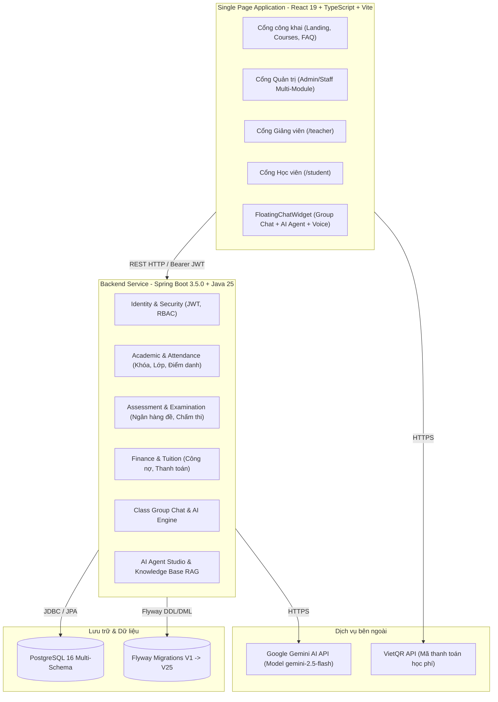

# BÁO CÁO HIỆN TRẠNG KIẾN TRÚC HỆ THỐNG CH ACADEMY (CURRENT ARCHITECTURE)

## 1. TỔNG QUAN KIẾN TRÚC HIỆN TẠI

CH Academy hiện là hệ thống quản trị đào tạo và học tập trực tuyến tích hợp AI được xây dựng theo mô hình monolithic phân tầng (modular monolith) với các thành phần chính:

---

## 2. ĐÁNH GIÁ CHI TIẾT CÁC PHÂN HỆ VÀ ĐIỂM NGHẼN

### 2.1. Phân hệ Identity & Multi-Portal RBAC
- **Hiện trạng:**
  - Hỗ trợ đầy đủ các vai trò: `SUPER_ADMIN`, `CENTER_ADMIN`, `ADMIN`, `ACADEMIC_STAFF`, `ADMISSIONS_STAFF`, `ACCOUNTANT`, `TEACHER`, `STUDENT`.
  - Token JWT chứa danh sách Roles & Permissions.
- **Rủi ro & Điểm yếu đã phát hiện và khắc phục:**
  - Trước đây, trong `StudentPortalController.java` và `AssessmentAnalyticsController.java` tồn tại cơ chế ngầm tự động gán fallback sang học viên `HV20240002` khi tài khoản Admin đăng nhập. Đã loại bỏ hoàn toàn fallback demo này, bảo đảm Admin và Student độc lập 100%.

### 2.2. Phân hệ Tin nhắn Nhóm (Class Group Chat)
- **Hiện trạng:**
  - Hỗ trợ chat theo từng lớp học giữa Giảng viên và Học viên trong lớp.
  - Sử dụng bảng `chat_conversations`, `chat_members`, `chat_messages`.
- **Rủi ro trước kiểm toán:**
  - Tài khoản Admin khi chưa đăng ký là thành viên nhóm lớp sẽ bị tính toàn bộ tin nhắn lịch sử thành unread do `last_read_message_id` bị `null`.
  - Khi xem tin nhắn, bộ đếm unread không giảm tức thì trên thanh điều hướng do thiếu optimistic update và event bus nội bộ.
- **Giải pháp áp dụng:**
  - Thêm `client_msg_id` chống trùng lặp tin nhắn (idempotency).
  - Tự động ghi nhận `ChatMember` cho Admin khi mở xem hội thoại để reset unread count về 0.
  - Tối ưu truy vấn `countUnreadMessagesExcludingSender` không đếm tin nhắn do chính mình gửi.

### 2.3. Phân hệ AI Agent Studio & GenAI Chat Box
- **Hiện trạng:**
  - Có giao diện cấu hình Agent (`/admin/ai-studio`) và FloatingChatWidget ở mọi cổng.
  - Phân tách theo cổng: `STUDENT` $\rightarrow$ Trợ lý Học tập, `TEACHER` $\rightarrow$ Trợ lý Giảng viên, `ADMIN` $\rightarrow$ Trợ lý Quản trị, `PUBLIC` $\rightarrow$ Tư vấn viên Tuyển sinh.
  - Phân quyền: Đã tích hợp Flyway `V24` cấp quyền `ai:manage`, `ai:read`, `ai:use` cho Admin, ngăn chặn triệt để lỗi 403 Forbidden.

### 2.4. Phân hệ Voice AI đàm thoại
- **Hiện trạng:**
  - Tích hợp Web Audio API (Realtime Analyser Canvas) và Web Speech API (STT SpeechRecognition + TTS SpeechSynthesis).
  - Chu trình trạng thái: `IDLE` $\rightarrow$ `CONNECTING` $\rightarrow$ `LISTENING` $\rightarrow$ `PROCESSING` $\rightarrow$ `SPEAKING` $\rightarrow$ `MUTED` $\rightarrow$ `ENDED`.
  - Bảng `call_sessions` lưu vết thời lượng và lịch sử cuộc gọi.

