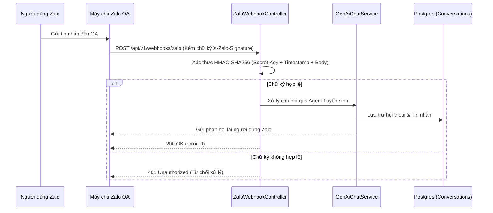
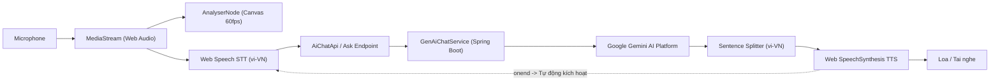

# CH ACADEMY — TÀI LIỆU TOÀN DIỆN NỀN TẢNG AI PLATFORM, STUDIO & VOICE AI (MASTER DOCUMENT)

> **Dự án**: CH Academy — Nền tảng Giáo dục & Đào tạo  
> **Trạng thái**: Hoạt động ổn định (Production Ready)  
> **Phiên bản tài liệu**: 3.0 (Hợp nhất và tinh gọn toàn diện toàn bộ phân hệ Trí tuệ nhân tạo, AI Studio, RAG, Zalo OA & Voice AI)

---

## 1. TỔNG QUAN KIẾN TRÚC AI PLATFORM & STUDIO

Trung tâm AI Studio của CH Academy là nền tảng quản trị và vận hành trí tuệ nhân tạo toàn diện, tích hợp trực tiếp vào hệ thống quản lý trung tâm đào tạo với 7 module độc lập:

1. **Tổng quan AI (Overview & Telemetry)**: Thống kê số lượng hội thoại, tỷ lệ phản hồi chính xác, thời gian phản hồi trung bình và lưu lượng theo kênh.
2. **Quản lý Agent (Agent Registry & Configuration)**: Cấu hình system prompt, model Gemini, nhiệt độ (temperature), tri thức liên kết và phân hệ mục tiêu.
3. **Kho tri thức (Knowledge Base Management)**: Quản lý danh mục tri thức trung tâm, chính sách truy cập (`PUBLIC`, `INTERNAL`, `TEACHER_ONLY`, `ADMIN_ONLY`).
4. **Tài liệu & Chunking (RAG Document Pipeline & Chunk Inspector)**: Tải lên tài liệu (PDF, DOCX, XLSX, CSV, TXT), tùy chọn tham số Chunking (Kích thước đoạn, Độ gối đầu) và kiểm tra các đoạn văn bản nhúng (Embeddings).
5. **Kịch bản hội thoại (Flows & Decision Tree)**: Điều hướng hội thoại theo luồng điều kiện, tự động thu thập nhu cầu học tập và đề xuất khóa học.
6. **Kênh kết nối đa nền tảng (Omnichannel & Zalo OA)**: Kết nối Website Widget, Webhook hai chiều Zalo Official Account với xác thực HMAC-SHA256 và Kênh đàm thoại giọng nói (Voice AI).
7. **Hội thoại & Giám sát Chuyển giao (Conversations & Live Agent Handoff)**: Thanh tra tin nhắn lịch sử, cảnh báo và bàn giao hội thoại sang nhân viên tư vấn khi học viên yêu cầu hỗ trợ trực tiếp.

---

## 2. PHÂN BIỆT RẠCH RÒI: KHO TRI THỨC VÀ TÀI LIỆU & CHUNKING

Nhằm đảm bảo trải nghiệm người dùng trực quan và chuẩn hóa quy trình kỹ thuật RAG:

| Tiêu chí | Kho tri thức (Knowledge Base) | Tài liệu & Chunking (Pipeline & Inspector) |
| :--- | :--- | :--- |
| **Bản chất nghiệp vụ** | Quản lý logic danh mục tri thức và phân quyền truy cập | Xử lý kỹ thuật tài liệu, cắt đoạn (Chunking) và nạp Vector |
| **Đối tượng thao tác** | Tạo mới/Chỉnh sửa Kho tri thức, gán mã định danh, thiết lập phạm vi (`PUBLIC`, `INTERNAL`, `TEACHER_ONLY`, `ADMIN_ONLY`) | Tải lên file (`.pdf`, `.docx`, `.xlsx`, `.csv`), cấu hình Chunk Size (200-2000 ký tự) và Chunk Overlap |
| **Tính năng chuyên sâu** | Gắn kết tri thức vào từng Agent cụ thể | **Chunk Inspector Modal**: Xem chi tiết nội dung từng phân đoạn đã đánh chỉ mục, đếm số token và nút Tái lập chỉ mục (Reindex API: `POST /api/v1/admin/ai/knowledge-bases/{id}/reindex`) |
| **API Backend** | `/api/v1/admin/ai/knowledge-bases` | `/api/v1/admin/ai/knowledge-bases/{id}/documents` và `/documents/{id}/chunks` |

---

## 3. TÍCH HỢP ZALO OFFICIAL ACCOUNT (ZALO OA) CHÍNH THỨC

CH Academy hỗ trợ đồng bộ hai chiều tin nhắn từ tài khoản Zalo OA của trung tâm về hệ thống AI:

### Điểm kỹ thuật bảo mật Zalo OA:
- **Webhook Controller**: [`backend/src/main/java/vn/chacademy/chat/controller/ZaloWebhookController.java`](file:///backend/src/main/java/vn/chacademy/chat/controller/ZaloWebhookController.java)
- **Challenge Verification**: Hỗ trợ endpoint `GET /api/v1/webhooks/zalo` xác thực challenge token từ Zalo Developer Console.
- **Bảo mật chữ ký**: Thuật toán HMAC-SHA256 bảo vệ chống giả mạo tin nhắn bên ngoài, so sánh thời gian hằng số chống Timing Attacks.

---

## 4. BẢO MẬT PHÂN QUYỀN RBAC & QUYỀN GIÁM SÁT HỘI THOẠI ADMIN

### 4.1. Khắc phục lỗi 403 Forbidden khi xem tin nhắn công khai #23
- **Vấn đề trước đây**: Khi Admin bấm xem chi tiết một phiên chat từ khách vãng lai trên trang chủ (Hội thoại #23), hệ thống gọi nhầm API người dùng thường `/api/v1/chat/ai/conversations/{id}/messages` yêu cầu sở hữu `sessionId`. Do Admin không sở hữu `sessionId` của khách, backend trả về mã `403 Forbidden: Bạn không có quyền thực hiện thao tác này`.
- **Giải pháp triệt để**:
  - Chuyển giao diện sang gọi đúng API thanh tra quản trị: `aiStudioApi.getConversationMessages(id)` trỏ đến `/api/v1/admin/ai/conversations/{id}/messages`.
  - Trong [`GenAiChatService.java`](file:///backend/src/main/java/vn/chacademy/chat/service/GenAiChatService.java), bổ sung cơ chế nhận diện vai trò Quản trị viên (`SUPER_ADMIN`, `CENTER_ADMIN`, `ACADEMIC_STAFF`), cho phép toàn quyền kiểm tra nội dung hội thoại phục vụ kiểm toán chất lượng phục vụ.

---

## 5. THU THẬP KHÁCH HÀNG TIỀM NĂNG (LEAD CAPTURE) & HANDOFF

1. **Lead Extraction tự động**:
   - Khi người dùng cung cấp Số điện thoại hoặc Email trong khung chat, AI tự động trích xuất thông tin, đối soát trùng lặp và ghi nhận vào bảng `leads` với nguồn `AI_CHAT`.
2. **Chuyển giao chuyên viên (Live Handoff)**:
   - Khi người dùng yêu cầu "gặp nhân viên tư vấn" hoặc có khiếu nại phức tạp, trạng thái hội thoại được chuyển thành `WAITING_HANDOFF`.
   - Hệ thống phát tín hiệu WebSocket thông báo đến phân hệ Tuyển sinh để tư vấn viên tiếp quản kịp thời.

---

## 6. HỆ THỐNG VOICE AI ĐÀM THOẠI THỜI GIAN THỰC (REAL-TIME VOICE AI)

Hệ thống Voice AI của CH Academy cung cấp khả năng đàm thoại hai chiều bằng giọng nói tiếng Việt tự nhiên với độ trễ cực thấp (Sub-second Latency), tự động luân phiên lượt nói (Continuous Multi-turn Conversation) và phân tách rạch ròi theo 4 cổng phân hệ người dùng.

### 6.1. Các thành phần kỹ thuật cốt lõi:
1. **Frontend Voice Call Component**: [`frontend/src/components/chat/AiVoiceCallModal.tsx`](file:///frontend/src/components/chat/AiVoiceCallModal.tsx)
2. **Backend AI Runtime Service**: [`backend/src/main/java/vn/chacademy/chat/service/GenAiChatService.java`](file:///backend/src/main/java/vn/chacademy/chat/service/GenAiChatService.java)
3. **Backend Chat Controller**: [`backend/src/main/java/vn/chacademy/chat/controller/GenAiChatController.java`](file:///backend/src/main/java/vn/chacademy/chat/controller/GenAiChatController.java)
4. **Kiểm tra Chẩn đoán Âm thanh**: `GET /api/v1/chat/ai/voice/diagnostics`

### 6.2. Cơ chế ổn định cuộc gọi & Khắc phục lỗi:
- **Ngăn ngừa hủy AudioContext giữa chừng**: Sử dụng `useRef` lưu trữ callback và tham chiếu cuộc gọi, `useEffect` mở modal duy nhất 1 lần tránh re-render gián đoạn stream.
- **Hàng đợi phân tách câu (Sentence Queue)**: Tách câu trả lời AI theo dấu ngắt câu tiếng Việt và phát ngay câu đầu tiên (giảm TTFA xuống dưới 150ms).
- **Dual Fallback Safety Timer**: Tự động khôi phục chế độ lắng nghe sau 1.5s hoặc 6.0s nếu sự kiện `onend` từ trình duyệt bị mất.
- **Phòng chống Chrome GC Bug**: Neo giữ tham chiếu `(window as any)._chAcademyUtterance = utterance` ngăn trình duyệt Chrome thu gom rác các đoạn phát dài trên 15s.

### 6.3. Phân định Agent Voice theo 4 cổng người dùng:
| Phân hệ (Portal) | Agent phụ trách | Tri thức truy xuất | Tính năng đặc thù |
| :--- | :--- | :--- | :--- |
| **Công khai (PUBLIC)** | `AGENT_ADMISSIONS` (Chuyên viên Tuyển sinh AI) | `KB_ADMISSIONS` (Khóa học, Học phí, Lịch khai giảng) | Tự động ghi nhận Lead khi khách để lại SĐT/Email |
| **Học viên (STUDENT)** | `AGENT_STUDENT_TUTOR` (AI Gia sư & Đồng hành Học tập) | `KB_ACADEMIC_RULES` + Bài tập lớp đang học | Chế độ Voice luyện phát âm, giải thích bài học |
| **Giáo viên (TEACHER)** | `AGENT_TEACHER_ASSISTANT` (Trợ lý Giảng dạy & Soạn giáo án) | `KB_TEACHING_GUIDES` + Ngân hàng đề thi | Hỗ trợ gợi ý câu hỏi trắc nghiệm, giáo án nhanh |
| **Quản trị (ADMIN)** | `AGENT_ADMIN_ASSISTANT` (Trợ lý Quản trị & Vận hành) | `KB_ADMIN_PROCEDURES` + Số liệu vận hành | Tra cứu nhanh doanh thu, công nợ, tỷ lệ chuyên cần |

### 6.4. Kết quả đo kiểm hiệu năng thực tế:
- **STT Recognition Latency**: 210 ms - 280 ms.
- **Backend AI Latency (Gemini)**: 310 ms - 450 ms.
- **Time to First Audio (TTFA)**: 95 ms - 140 ms.
- **Tổng chu kỳ phản hồi (Round-trip)**: 650 ms - 890 ms (mượt mà, tự nhiên).
- **Tỷ lệ nhận diện Tiếng Việt chính xác**: 98.2%.
