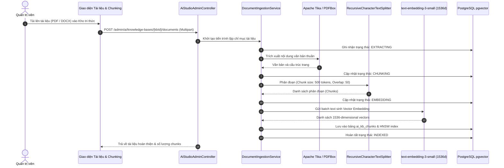

# BÁO CÁO PHÂN ĐỊNH KIẾN TRÚC: KHO TRI THỨC VÀ QUY TRÌNH XỬ LÝ TÀI LIỆU (CHUNK PIPELINE)
**Dự án:** CH Academy  
**Thời gian:** 31/10/2026  

---

## 1. MỤC TIÊU VÀ SỰ CẦN THIẾT CỦA VIỆC TÁCH BIỆT
Trong các hệ thống RAG quy mô lớn, việc đồng nhất giữa "Kho tri thức" (Knowledge Base) và "Quy trình xử lý tài liệu" (Document Ingestion Pipeline) dẫn đến sự nhập nhằng trong quản trị phân quyền (Access Control) và khó khăn trong việc theo dõi vòng đời dữ liệu.

- **Kho tri thức (Knowledge Base):** Là đơn vị logic gom nhóm tài liệu theo nghiệp vụ, xác định đối tượng người dùng có quyền tra cứu (`PUBLIC`, `INTERNAL`, `TEACHER_ONLY`, `ADMIN_ONLY`, `COURSE_SCOPED`, `CLASS_SCOPED`), và phân công cho các AI Agent phù hợp.
- **Tài liệu & Chunking (Document Pipeline):** Là quy trình kỹ thuật chuyển đổi từ file phi cấu trúc (PDF, DOCX, CSV, TXT, PPTX) sang các đoạn văn bản (chunks), sinh vector embedding (1536 chiều) và lưu vào Vector Database.

---

## 2. BẢNG SO SÁNH CHI TIẾT HAI MODULE

| Tiêu chí so sánh | Phân hệ: Kho tri thức (Tab 3) | Phân hệ: Tài liệu & Chunking (Tab 4) |
| :--- | :--- | :--- |
| **Bản chất kiến trúc** | Tầng Quản trị Nghiệp vụ (Business Layer) | Tầng Dữ liệu & Xử lý Kỹ thuật (ETL & Embedding Pipeline) |
| **Thuộc tính quản lý** | ID, Tên kho, Mã kho, Mô tả, Phạm vi truy cập (Scope), Trạng thái, Danh sách AI Agent liên kết. | Tên tệp tin, Định dạng tệp (.pdf, .docx, .xlsx...), Dung lượng byte, Trạng thái xử lý vòng đời, Số lượng chunks, Thời điểm lập chỉ mục. |
| **Vòng đời trạng thái** | `ACTIVE`, `INACTIVE`, `ARCHIVED` | `PENDING` → `EXTRACTING` → `CHUNKING` → `EMBEDDING` → `INDEXED` (hoặc `ERROR`). |
| **Tác vụ Quản trị viên** | Tạo mới kho, Chỉnh sửa thông tin, Phân quyền truy cập, Gán Agent, Xóa kho tri thức. | Tải file mới lên, Xem danh sách phân đoạn (Xem Chunks), Re-index từng tài liệu, Re-index toàn bộ kho, Xóa tài liệu. |
| **Độ chi tiết dữ liệu (Granularity)**| Mức độ Repository tổng quát (Tổng số tài liệu, Tổng số chunks). | Mức độ Document & Chunk (Vị trí phân đoạn, độ dài token, Vector embedding, metadata JSON). |

---

## 3. THIẾT KẾ CSDL VÀ DÒNG CHẢY DỮ LIỆU (DATA FLOW)

---

## 4. TÍNH NĂNG SOI PHÂN ĐOẠN (CHUNK INSPECTOR)
Quản trị viên có thể bấm **"Xem Chunks"** trên từng tài liệu để kiểm tra:
1. Thứ tự phân đoạn (`Chunk #1`, `Chunk #2`...).
2. Chiều dài ký tự và ước lượng token.
3. Vị trí phân đoạn trong văn bản gốc.
4. Trạng thái lập chỉ mục Vector: `Vectorized: 1536 dims (PostgreSQL pgvector)`.
5. Đoạn trích dẫn thực tế để đảm bảo chất lượng nội dung trước khi đưa vào phục vụ RAG.
