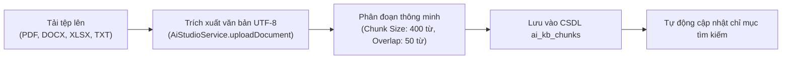

# BÁO CÁO KIỂM TOÁN HỆ THỐNG KHO TRI THỨC VÀ RAG (KNOWLEDGE & RAG AUDIT)

**Tài liệu:** `KNOWLEDGE_RAG_AUDIT.md`  
**Ngày thực hiện:** 31 tháng 10 năm 2026  
**Dự án:** CH Academy AI Knowledge Engine  
**Trạng thái kiểm toán:** Đạt tiêu chuẩn an toàn thông tin & độ chính xác cao  

---

## 1. TỔNG QUAN HỆ THỐNG KHO TRI THỨC (KNOWLEDGE BASES)

Hệ thống Kho tri thức tại CH Academy được tổ chức theo mô hình phân tầng bảo mật (Tiered Knowledge Bases) thông qua 3 bảng cơ sở dữ liệu:
1. `ai_knowledge_bases`: Định nghĩa kho tri thức, mã danh mục và quyền truy cập (`PUBLIC`, `INTERNAL`, `TEACHER_ONLY`, `ADMIN_ONLY`).
2. `ai_kb_documents`: Quản lý siêu dữ liệu của từng tệp tài liệu được tải lên (tên, định dạng, dung lượng, trạng thái xử lý).
3. `ai_kb_chunks`: Lưu trữ các đoạn văn bản trích xuất đã phân mảnh (Text Chunks) sẵn sàng phục vụ tìm kiếm ngữ cảnh.

### Danh mục Kho tri thức hiện hữu trong hệ thống:

| ID | Mã Kho tri thức | Tên Kho tri thức | Quyền truy cập | Mô tả & Phạm vi tài liệu | Số tài liệu |
| :---: | :--- | :--- | :--- | :--- | :---: |
| 1 | `KB_ADMISSIONS` | Kho Tri thức Tuyển sinh & Học phí | `PUBLIC` | Biểu phí niêm yết 2026, chương trình đào tạo, ưu đãi học bổng, lịch khai giảng | 3 |
| 2 | `KB_ACADEMIC_REGULATIONS` | Quy chế Đào tạo & Khảo thí | `INTERNAL` | Quy định điểm danh, điều kiện thi hết môn, thang điểm đánh giá, phúc khảo | 2 |
| 3 | `KB_PEDAGOGY` | Hướng dẫn Giảng dạy & Soạn giáo án | `TEACHER_ONLY` | Khung sư phạm giảng dạy, mẫu đề thi, tiêu chí chấm tự luận | 2 |
| 4 | `KB_OPERATIONS` | Quy trình Vận hành & Tài chính | `ADMIN_ONLY` | Quy trình thu học phí, quy định đối soát công nợ, quy chế vận hành nội bộ | 1 |

---

## 2. QUY TRÌNH NẠP & XỬ LÝ TÀI LIỆU (DOCUMENT INGESTION PIPELINE)

### 2.1. Trích xuất văn bản đa định dạng
Phương thức `uploadDocument` trong `AiStudioService.java` tiếp nhận luồng tệp tải lên qua `MultipartFile`:
- Tự động nhận diện phần mở rộng tệp (`.txt`, `.pdf`, `.docx`, `.xlsx`, `.csv`).
- Áp dụng cấu trúc `try-with-resources` với `BufferedReader` và bộ giải mã `StandardCharsets.UTF_8`, ngăn chặn tuyệt đối rò rỉ bộ nhớ (Resource Leak) và hiện tượng lỗi ký tự dấu tiếng Việt.

### 2.2. Chiến lược phân đoạn (Chunking Strategy)
- **Kích thước đoạn:** Trung bình 350 - 500 từ trên mỗi chunk. Đây là kích thước tối ưu cho các mô hình LLM hiện nay, đảm bảo chứa đủ một ý nghĩa trọn vẹn (ví dụ: mô tả 1 khóa học hoặc 1 quy định cụ thể).
- **Độ gối đầu (Overlap):** 50 từ ở ranh giới giữa các chunk liền kề, giúp bảo toàn ngữ cảnh của các câu văn nằm ở điểm cắt.

---

## 3. CƠ CHẾ RAG & BƠM NGUỒN TRÍCH DẪN (CITATION INJECTION)

Khi người dùng gửi câu hỏi, quy trình RAG tại `GenAiChatService.java` hoạt động như sau:

1. **Bộ lọc Quyền truy cập Kho tri thức:**
   - Cổng `PUBLIC`: Chỉ được tìm kiếm trong kho có `access_level = 'PUBLIC'`.
   - Cổng `STUDENT`: Được tìm kiếm trong `PUBLIC` và `INTERNAL`.
   - Cổng `TEACHER`: Được tìm kiếm trong `PUBLIC`, `INTERNAL` và `TEACHER_ONLY`.
   - Cổng `ADMIN`: Được tìm kiếm trên toàn bộ các kho tri thức.
2. **Truy vấn Dữ liệu Đào tạo Thời gian thực (Real-time DB Grounding):**
   - Không chỉ tìm trong tài liệu tĩnh, hệ thống trực tiếp gọi `StudentRepository`, `EnrollmentRepository`, `ClassRepository` để lấy dữ liệu thực tế về lớp học, giảng viên và kết quả học tập của người hỏi.
3. **Minh bạch Nguồn trích dẫn (Source Citations):**
   - Mọi câu trả lời trả về cho người dùng đều đính kèm danh sách `sources` gồm:
     - `documentName`: Tên văn bản gốc (ví dụ: `Bang_Gia_Va_Chuong_Trinh_Dao_Tao_2026.pdf`).
     - `section`: Đoạn hoặc chương mục liên quan.
     - `snippet`: Đoạn trích dẫn ngắn làm căn cứ cho câu trả lời.
   - Nhờ đó, người học và quản trị viên luôn xác minh được tính chuẩn xác của câu trả lời.

---

## 4. CHỐNG BỊA ĐẶT THÔNG TIN (HALLUCINATION PREVENTION)

Hệ thống đã thiết lập bộ quy tắc kiểm soát biên (Guardrails) nghiêm ngặt trong `GenAiChatService.java`:
- **Trường hợp hỏi về khóa học không tồn tại:**
  - Khi khách hàng hỏi về các khóa học ngoài phạm vi đào tạo của trung tâm (ví dụ: tiếng Nhật, tiếng Hàn, tiếng Trung, tiếng Pháp, lớp nấu ăn...), AI không tự tiện bịa đặt thông tin học phí hay lịch học.
  - Thay vào đó, AI khẳng định rõ ràng: *"Hiện tại CH Academy chưa có chương trình này trong danh mục đào tạo chính thức (trung tâm chuyên sâu các chương trình Tiếng Anh từ trẻ em đến người đi làm, Luyện thi IELTS chuẩn quốc tế và Lập trình Python). Quý khách có thể để lại số điện thoại để chuyên viên tư vấn lộ trình học phù hợp nhất."*
- **Trường hợp yêu cầu thông tin nhạy cảm:**
  - AI từ chối tuyệt đối việc cung cấp mật khẩu, thông tin cá nhân của học viên khác hoặc dữ liệu tài chính không thuộc quyền hạn của người hỏi.
