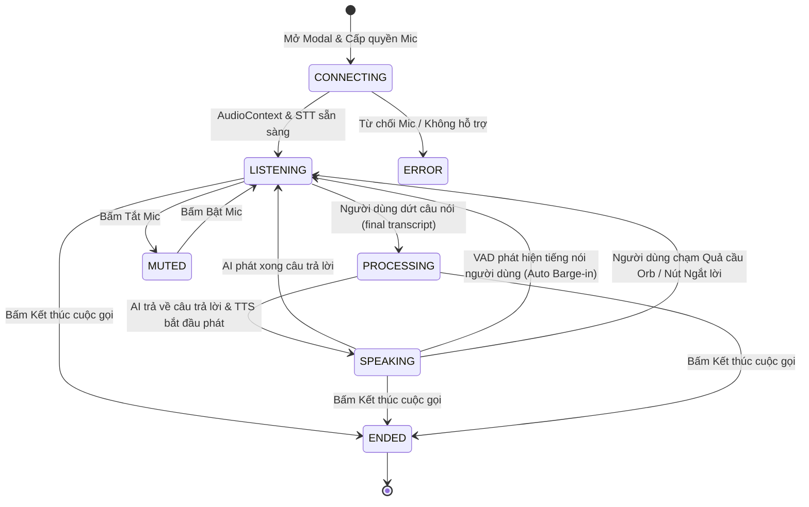

# KIẾN TRÚC REAL-TIME VOICE AI CONVERSATION — CH ACADEMY

**Tài liệu thiết kế:** Kiến trúc Giao tiếp Giọng nói Bán Song công với Auto Barge-In  
**Tiêu chuẩn kỹ thuật:** CH Academy Realtime Voice Engine & Web Audio API  
**Cập nhật:** 31/10/2026  

---

## I. MỤC TIÊU KIẾN TRÚC VOICE AI

Giải quyết triệt để vấn đề cuộc gọi bị "đơ", trạng thái "Đang lắng nghe..." kéo dài, vùng hội thoại bị trống hoặc gián đoạn giữa các lượt nói.

Hệ thống cung cấp trải nghiệm hội thoại giọng nói **tự nhiên, đa lượt (multi-turn), liên tục**:
- Người dùng nói ➔ Nhận dạng tức thời (Interim preview) ➔ Gửi AI ➔ AI phản hồi bằng giọng nói (TTS) ➔ Người dùng có thể cất giọng để ngắt lời AI bất cứ lúc nào (Barge-In) và hỏi tiếp.

---

## II. SƠ ĐỒ MÁY TRẠNG THÁI (CALL STATE MACHINE)

---

## III. CÁC ĐẶC TÍNH KỸ THUẬT CỐT LÕI

### 1. Thu nhận âm thanh & Tính RMS qua Web Audio API
- Sử dụng `navigator.mediaDevices.getUserMedia` với cấu hình chống vang, lọc ồn (`echoCancellation: true, noiseSuppression: true, autoGainControl: true`).
- Kết nối `MediaStreamSource` vào `AnalyserNode` (`fftSize = 256`).
- Tính toán năng lượng âm thanh thực tế theo công thức Root Mean Square (RMS):
  $$RMS = \sqrt{\frac{1}{N}\sum_{i=0}^{N-1} x_i^2}$$
- Cường độ RMS này trực tiếp điều khiển:
  - Chiều cao các cột sóng Canvas Oscilloscope.
  - Tỷ lệ co giãn của Quả cầu năng lượng Orb: $\text{Scale} = 1 + \min(0.28, RMS \times 3.5)$.
  - Khi người dùng im lặng, sóng âm lập tức trở về đường chân trời phẳng tĩnh lặng, không dùng animation giả lập.

### 2. Thuật toán phát hiện giọng nói tự động ngắt lời (VAD Auto Barge-In)
- Khi trạng thái là `SPEAKING` (AI đang phát âm thanh), luồng phân tích RMS liên tục giám sát micro của người dùng.
- Nếu $RMS > 0.045$ trong hơn 3 frames liên tiếp (chứng tỏ người dùng đang cất giọng nói chứ không phải tiếng ồn ngẫu nhiên):
  - Lập tức kích hoạt `window.speechSynthesis.cancel()`.
  - Hủy phát âm thanh hiện tại.
  - Chuyển trạng thái sang `LISTENING` và kích hoạt bộ thu STT để tiếp nhận câu hỏi mới.

### 3. Lưu trữ & Trình bày Lịch sử Hội thoại Trực tiếp (Live Transcripts)
- Vùng hội thoại lưu trữ toàn bộ các lượt thoại (`recentTranscripts`) với đầy đủ người nói, nội dung, mốc thời gian.
- Hiển thị trực tiếp nội dung đang nói dở (`userTranscript` - interim speech) dưới dạng khối phát sáng để người dùng biết hệ thống đang lắng nghe chính xác từng từ.

