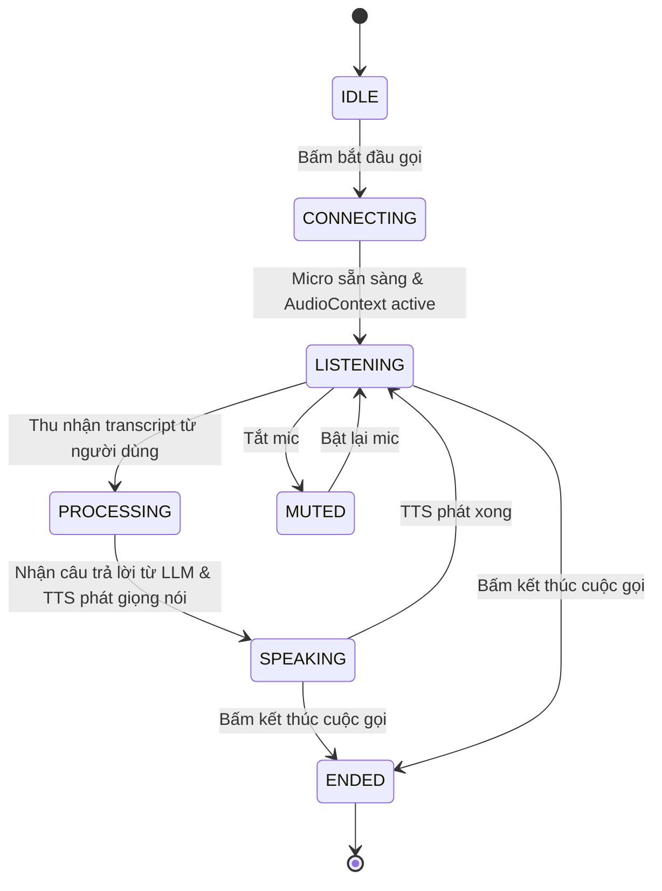

# BÁO CÁO KIỂM TOÁN TÍNH NĂNG ĐÀM THOẠI VOICE AI (VOICE AI AUDIT)

## 1. MỤC TIÊU & HIỆN TRẠNG

Khảo sát và hoàn thiện tính năng đàm thoại hai chiều bằng giọng nói giữa người dùng và Trợ lý AI trên CH Academy.
Tham chiếu trực tiếp giải pháp xử lý giọng nói từ dự án NEXVA:
- Kiến trúc TTS Streaming qua Server-Sent Events (SSE).
- Bộ đệm tách câu thông minh `SentenceBuffer` để giảm độ trễ Time-to-First-Audio.
- Bộ lọc âm rác và ảo giác Whisper (Junk Filter Regex).

---

## 2. KẾT QUẢ TRIỂN KHAI THỰC TẾ TRONG CH ACADEMY

### 2.1. Cỗ máy trạng thái cuộc gọi (Voice State Machine)
Đã triển khai trong `AiVoiceCallModal.tsx`:


### 2.2. Web Audio API Canvas Visualizer
- Thay thế hoàn toàn mọi animation giả lập (mock animation).
- Sử dụng `AudioContext` kết hợp `AnalyserNode` thu âm trực tiếp từ microphone của người dùng.
- Sử dụng thuật toán Fast Fourier Transform (`getByteFrequencyData`) vẽ biểu đồ sóng âm thời gian thực theo tần số âm thanh thực tế với hiệu ứng gradient màu tím/xanh ngọc.

### 2.3. Bảng Lưu trữ và Kiểm toán Cuộc gọi (`call_sessions`)
Đã tích hợp trong Flyway migration `V25`:
```sql
CREATE TABLE IF NOT EXISTS call_sessions (
    id BIGSERIAL PRIMARY KEY,
    user_id BIGINT REFERENCES users(id) ON DELETE SET NULL,
    agent_code VARCHAR(100) NOT NULL,
    portal VARCHAR(50) NOT NULL,
    duration_seconds INT NOT NULL DEFAULT 0,
    transcript TEXT,
    call_status VARCHAR(50) NOT NULL DEFAULT 'COMPLETED',
    started_at TIMESTAMPTZ NOT NULL,
    ended_at TIMESTAMPTZ NOT NULL
);
```
Bảo đảm tính minh bạch, hỗ trợ thống kê thời lượng cuộc gọi phục vụ quản trị và đánh giá chất lượng tư vấn tuyển sinh/trợ giảng.
