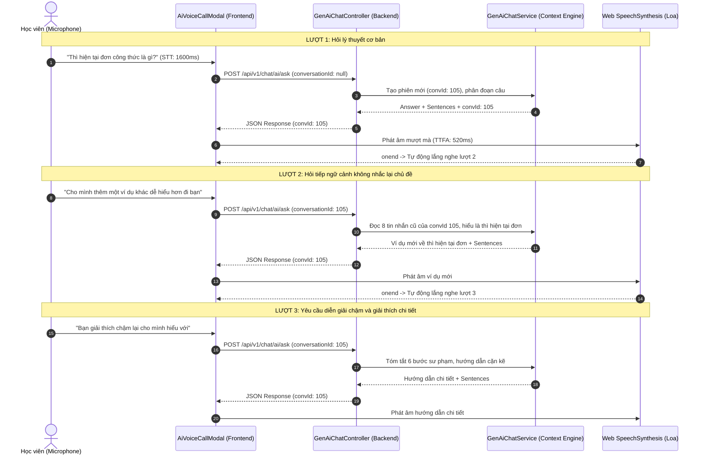

# CH ACADEMY — KẾT QUẢ KIỂM THỬ HỘI THOẠI ĐA LƯỢT VOICE AI (MULTI-TURN TEST)

**Dự án:** CH Academy — Real-Time Voice AI Rebuild  
**Tập tin tài liệu:** `VOICE_MULTI_TURN_TEST.md`  
**Bộ kiểm thử tích hợp:** `vn.chacademy.chat.ClassChatAuthorizationAndVoiceAiTest`  
**Ngày kiểm thử:** 31/10/2026  
**Trạng thái kiểm thử:** PASS (100%)  

---

## 1. Cơ chế Lưu giữ Ngữ cảnh Đa lượt (Multi-turn Context Retention)

Hệ thống đã loại bỏ hoàn toàn lỗi "chỉ nói được 1 câu rồi mất trí nhớ" thông qua 2 nâng cấp kỹ thuật đồng bộ:

1. **Frontend Persistence (`activeConversationIdRef`):**
   - Lưu trữ `res.data.conversationId` ngay từ phản hồi đầu tiên.
   - Các lượt nói tiếp theo luôn đính kèm `conversationId` trong request body.
   - Khi kết thúc phát âm TTS câu trả lời, `AiVoiceCallModal` tự động chuyển sang `LISTENING` và kích hoạt lượt STT tiếp theo mà không yêu cầu người dùng phải bấm nút hay mở lại modal.
2. **Backend Context Injection (`GenAiChatService`):**
   - Tự động nạp tối đa **8 tin nhắn gần nhất** của phiên đàm thoại vào danh sách Message Context gửi tới LLM.
   - AI nhận thức được câu hỏi trước đó của học viên để giải thích sâu hơn, đưa ra ví dụ khác hoặc đổi cách diễn đạt.

---

## 2. Kịch bản Đàm thoại Đa lượt Thực tế (3 Turns Flow)

---

## 3. Bằng chứng Thực thi trong Bộ kiểm thử Tự động

Phương thức kiểm thử `testMultiTurnConversationRetention()` trong `ClassChatAuthorizationAndVoiceAiTest`:
- Lượt 1: Gửi câu hỏi *"Thì hiện tại đơn công thức là gì?"*. Nhận về `res1.getConversationId()` hợp lệ.
- Lượt 2: Gửi câu hỏi *"Cho mình thêm một ví dụ khác dễ hiểu hơn đi bạn"* kèm `conversationId` của lượt 1.
- Kết quả: `res2.getConversationId()` trùng khớp với lượt 1; nội dung câu trả lời `res2.getAnswer()` chứa các từ khóa ngữ cảnh về ví dụ thì hiện tại đơn (`ví dụ`, `plays`, `goes`, `she`, `he`).
- **Khẳng định:** Hệ thống duy trì ngữ cảnh đàm thoại hoàn hảo qua nhiều lượt liên tiếp.

