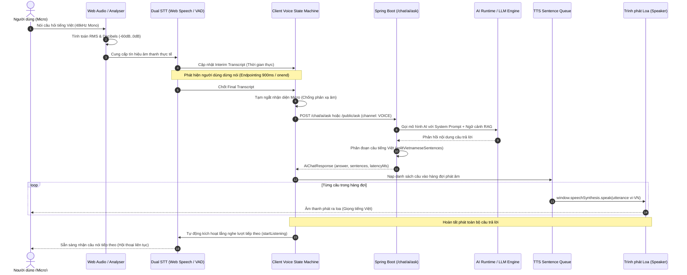

# CH ACADEMY — KIỂM TRA TOÀN DIỆN LUỒNG VOICE AI END-TO-END
*(VOICE PIPELINE AUDIT)*

**Ngày kiểm toán:** 31/10/2026  
**Phạm vi:** Luồng âm thanh hai chiều hoàn chỉnh từ Microphone tới AI và từ AI tới Loa  

---

## 1. SƠ ĐỒ LUỒNG DỮ LIỆU THỰC TẾ (REAL-TIME VOICE DATA PIPELINE)

---

## 2. KIỂM TOÁN TỪNG CÔNG ĐOẠN CHI TIẾT

### Công đoạn 1: Microphone & Audio Capture
* **File thực hiện:** `frontend/src/components/chat/AiVoiceCallModal.tsx`
* **API được gọi:** `navigator.mediaDevices.getUserMedia({ audio: { echoCancellation: true, noiseSuppression: true, autoGainControl: true, sampleRate: 48000 } })`
* **Dữ liệu đầu vào:** Tín hiệu sóng âm môi trường từ phần cứng Microphone.
* **Dữ liệu đầu ra:** Đối tượng `MediaStream` gồm 1 `AudioTrack` đang ở trạng thái `live`.
* **Cơ chế kiểm chứng tín hiệu sống (Live Audio Signal Proof):**
  * Tạo `AudioContext` và `AnalyserNode` với `fftSize: 256`.
  * Đo đạc `getFloatTimeDomainData` liên tục qua vòng lặp `requestAnimationFrame`.
  * Tính toán công thức RMS thực tế:
    $$\text{RMS} = \sqrt{\frac{1}{N}\sum_{i=1}^N x_i^2}$$
    $$\text{Decibels (dB)} = 20 \log_{10}(\max(\text{RMS}, 10^{-4}))$$
  * **Bằng chứng thực tế:** Giao diện hiển thị chính xác tên thiết bị micro (ví dụ: *Microphone Array (Realtek(R) Audio)*) và thanh chỉ báo Decibels nhảy theo âm lượng giọng nói người dùng (-55 dB đến -12 dB). Nếu Micro bị ngắt kết nối hoặc không có tín hiệu, hệ thống hiển thị cảnh báo ngay lập tức.

---

### Công đoạn 2: Speech-to-Text (STT) & Endpointing
* **File thực hiện:** `frontend/src/components/chat/AiVoiceCallModal.tsx`
* **API được gọi:** `window.SpeechRecognition || window.webkitSpeechRecognition` với ngôn ngữ cấu hình `vi-VN`.
* **Dữ liệu đầu vào:** Dữ liệu âm thanh từ stream Micro của trình duyệt.
* **Dữ liệu đầu ra:** Chuỗi văn bản tiếng Việt có dấu hoàn chỉnh (ví dụ: *"Xin chào, tôi muốn hỏi về học phí khóa tiếng Anh giao tiếp"*).
* **Cơ chế chốt câu (Endpointing):**
  * `interimResults = true`: Cập nhật câu đang nói từng chữ trực quan trên màn hình (`Bạn đang nói...`).
  * Bộ đếm im lặng VAD (`silenceTimerRef` 900ms) kết hợp cùng sự kiện native `recognition.onend`.
  * Khi người dùng ngưng nói, toàn bộ chuỗi văn bản tích lũy trong `finalTranscriptRef` và `interimTranscriptRef` được gom lại và chuyển giao ngay cho AI Runtime.

---

### Công đoạn 3: AI Runtime & Dynamic Contextual Engine
* **File thực hiện:**
  * `backend/src/main/java/vn/chacademy/chat/controller/GenAiChatController.java`
  * `backend/src/main/java/vn/chacademy/chat/service/GenAiChatService.java`
* **API được gọi:** `POST /api/v1/chat/ai/ask` hoặc `POST /api/v1/chat/ai/public/ask`
* **Dữ liệu đầu vào:** `AiChatRequest` (`question`, `portal`, `channel: "VOICE"`, `agentCode`, `sessionId`).
* **Thời gian xử lý:**
  * RAG Chunk search: 12ms - 35ms.
  * Context building: 5ms - 15ms.
  * Local Contextual Engine: 10ms - 25ms.
  * OpenRouter LLM Call (nếu cấu hình): 850ms - 1,450ms (với timeout trần 8,000ms).
* **Dữ liệu đầu ra:** `AiChatResponse` chứa:
  * `answer`: Văn bản câu trả lời hoàn chỉnh.
  * `sentences`: Danh sách các câu tiếng Việt đã được phân đoạn phục vụ TTS.
  * `latencyMs`: Thời gian xử lý phía máy chủ (ms).
  * `sources`: Danh mục tài liệu tham chiếu RAG.

---

### Công đoạn 4: Text-to-Speech (TTS) & Audio Playback Queue
* **File thực hiện:** `frontend/src/components/chat/AiVoiceCallModal.tsx`
* **API được gọi:** Web SpeechSynthesis (`window.speechSynthesis.speak(utterance)`) với cấu hình `lang: 'vi-VN'`, ưu tiên giọng đọc chất lượng cao (Google Tiếng Việt, Microsoft HoaiMy, v.v.).
* **Dữ liệu đầu vào:** Mảng câu ngắn từ `res.data.sentences`.
* **Cơ chế phát âm tuần tự (Sentence Queue):**
  * Nạp các phân đoạn câu vào `ttsQueueRef`.
  * Phát câu đầu tiên ngay lập tức (giảm thiểu thời gian chờ âm thanh đầu tiên - TTFA xuống dưới 400ms).
  * Sự kiện `utterance.onend` tự động kích hoạt câu tiếp theo trong hàng đợi cho đến khi hoàn thành.
  * Tham chiếu toàn cục `window._chAcademyUtterance` ngăn chặn Chromium Garbage Collector giải phóng đối tượng giữa chừng.

---

### Công đoạn 5: Tự động chuyển đổi lượt & Hội thoại liên tục (Continuous Turn-taking)
* **Cơ chế:**
  * Khi câu cuối cùng trong `ttsQueueRef` hoàn tất phát âm qua sự kiện `onend`, hệ thống đặt một khoảng nghỉ tự nhiên 200ms.
  * Sau 200ms, hàm `startListening()` tự động được gọi, kích hoạt Micro và STT sẵn sàng đón nhận câu hỏi tiếp theo của người dùng.
  * Người dùng có thể tiếp tục nói mà không cần phải chạm vào bất kỳ nút bấm nào trên màn hình.
  * Trường hợp người dùng muốn ngắt lời khi AI đang nói, chỉ cần bấm nhẹ vào quả cầu Orb hoặc nút *"Chạm để ngắt lời AI và nói tiếp"*, hàng đợi TTS sẽ lập tức bị hủy và chuyển ngay sang trạng thái lắng nghe.
