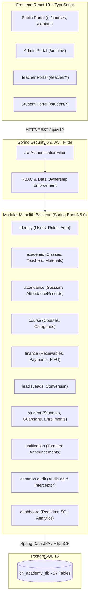
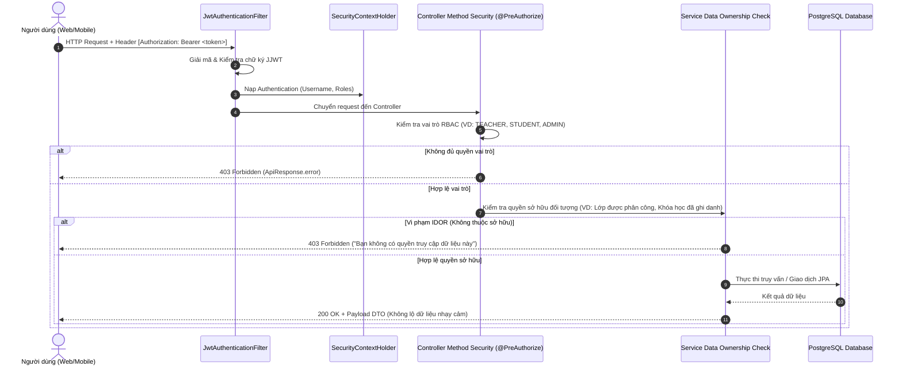

# CH ACADEMY — TÀI LIỆU KIẾN TRÚC HỆ THỐNG (ARCHITECTURE SPECIFICATION)

> **Dự án:** CH Academy — Multi-Portal Education Management Platform  
> **Kiến trúc:** Modular Monolith  
> **Backend:** Java 21, Spring Boot 3.5.0, Spring Data JPA, Spring Security 6  
> **Frontend:** React 19, TypeScript, Vite 8, React Router 7, Tailwind CSS  
> **Cơ sở dữ liệu:** PostgreSQL 16 (Flyway Migrations V1 - V11)

---

## 1. TỔNG QUAN KIẾN TRÚC MODULAR MONOLITH

Hệ thống CH Academy được tổ chức theo mô hình **Modular Monolith** kết hợp giao diện **Multi-Portal**. Lựa chọn này giúp đảm bảo:
- **Tính toàn vẹn giao dịch (ACID):** Cho phép các nghiệp vụ phức tạp (ví dụ: chuyển đổi Lead thành Student kèm khởi tạo tài khoản, sinh lịch học tự động) chạy trong cùng một transaction database `@Transactional`.
- **Dễ bảo trì và kiểm thử:** Các module backend được chia ranh giới theo miền nghiệp vụ (Domain-Driven Design), tránh phân tách microservices sớm gây phức tạp và tốn kém tài nguyên không cần thiết.
- **Trải nghiệm phân vai rõ ràng:** 3 cổng độc lập (`/admin`, `/teacher`, `/student`) phục vụ chính xác mục đích từng đối tượng người dùng.



---

## 2. PHÂN TÁCH MODULE BACKEND (DOMAIN BOUNDARIES)

Mã nguồn backend nằm trong package gốc `vn.chacademy.*`, gồm các module chính:

### 2.1. Module `identity`
- **Mục tiêu:** Quản lý tài khoản người dùng, băm mật khẩu, tạo và xác thực token JWT, lưu vết phiên đăng nhập.
- **Thực thể:** `User`, `Role`, `UserRole`.
- **Lớp bảo mật:** Băm mật khẩu bằng `BCryptPasswordEncoder` (strength 10), token ký bằng thuật toán HMAC-SHA256 chuẩn JJWT `0.12.6`.
- **Controller:** `AuthController` (`/api/v1/auth/login`, `/api/v1/auth/me`).

### 2.2. Module `academic`
- **Mục tiêu:** Quản trị các lớp học đang mở, phân công giáo viên giảng dạy, tải lên tài liệu học tập theo buổi học và phát hiện xung đột lịch.
- **Thực thể:** `ClassEntity`, `Teacher`, `TeacherAssignment`, `SessionMaterial`, `Classroom`, `ClassScheduleConfig`.
- **Controller:**
  - `ClassController` (`/api/v1/admin/classes`): Admin quản trị lớp học, cấu hình lịch và phân công.
  - `TeacherPortalController` (`/api/v1/teacher/portal/*`): Cổng làm việc dành riêng cho giáo viên.
  - `TeacherAssignmentAdminController` (`/api/v1/admin/teacher-assignments`): Admin theo dõi phân bổ giáo viên.

### 2.3. Module `attendance`
- **Mục tiêu:** Quản lý danh sách các buổi học thực tế (`class_sessions`) và bảng điểm danh học viên (`attendance_records`).
- **Thực thể:** `ClassSession`, `AttendanceRecord`.
- **Ràng buộc:** Ràng buộc duy nhất `(session_id, student_id)` ngăn chặn trùng lặp điểm danh.
- **Controller:**
  - `AttendanceController` (`/api/v1/admin/attendance`): Xem và cập nhật điểm danh.
  - `AttendanceMonitoringAdminController` (`/api/v1/admin/attendance-monitoring`): Admin theo dõi các lớp chưa điểm danh hoặc tỷ lệ chuyên cần thấp.

### 2.4. Module `student`
- **Mục tiêu:** Quản lý hồ sơ học viên, quan hệ N-N với người giám hộ (phụ huynh), ghi danh lớp học (`enrollment`).
- **Thực thể:** `Student`, `Guardian`, `StudentGuardian`, `Enrollment`.
- **Controller:**
  - `StudentController` (`/api/v1/admin/students`): Quản lý học viên và phụ huynh.
  - `StudentPortalController` (`/api/v1/student/portal/*`): Cổng tra cứu cá nhân của học sinh.

### 2.5. Module `finance`
- **Mục tiêu:** Quản lý nghĩa vụ tài chính học phí, lập khoản phải thu (`receivable`), ghi nhận thanh toán (`payment`), giảm trừ công nợ theo nguyên tắc FIFO và hoàn tiền có kiểm soát.
- **Thực thể:** `Receivable`, `Payment`, `PaymentAllocation`, `Refund`.
- **Ràng buộc:** Số tiền đã thanh toán không vượt quá khoản phải thu; mọi giao dịch thanh toán đều cập nhật trạng thái `PAID` hoặc `PARTIALLY_PAID`.

### 2.6. Module `lead`
- **Mục tiêu:** Quản lý phễu tuyển sinh (CRM): tiếp nhận tư vấn từ website công khai, phân loại trạng thái (`NEW` -> `CONTACTED` -> `CONSULTING` -> `WON` / `LOST`), chuyển đổi thành học viên chính thức trong một giao dịch nguyên tử.

### 2.7. Module `notification`
- **Mục tiêu:** Trung tâm thông báo và thông cáo nội bộ có phạm vi:
  - `ALL`: Toàn trung tâm.
  - `CLASS`: Học viên và giáo viên của một lớp cụ thể.
  - `TEACHERS`: Dành riêng cho giáo viên.
  - `STUDENTS`: Dành riêng cho học sinh.
  - `USER`: Cá nhân một người dùng.

### 2.8. Module `common.audit`
- **Mục tiêu:** Ghi lại nhật ký kiểm toán (`audit_logs`) đối với các hành vi quan trọng: phân công giáo viên, đổi điểm danh, sửa học phí, thay đổi trạng thái tài khoản.

---

## 3. KIẾN TRÚC BẢO MẬT VÀ PHÂN QUYỀN (SECURITY & RBAC)

Hệ thống áp dụng kiến trúc bảo mật đa tầng:



### 3.1. Danh mục vai trò nghiệp vụ (RBAC Roles)
1. `SUPER_ADMIN`: Toàn quyền hệ thống, cấu hình tham số, xem audit logs.
2. `CENTER_ADMIN`: Quản lý vận hành toàn trung tâm, duyệt lớp, mở khóa học.
3. `ACADEMIC_STAFF`: Quản lý đào tạo, phân công giáo viên, xếp lịch, theo dõi điểm danh.
4. `ADMISSIONS_STAFF`: Quản lý tuyển sinh, tiếp nhận và chuyển đổi khách hàng tiềm năng.
5. `ACCOUNTANT`: Quản lý học phí, ghi nhận thanh toán, theo dõi công nợ, xuất hóa đơn.
6. `TEACHER`: Xem lớp được phân công, điểm danh học viên, tải tài liệu bài học, đăng thông báo lớp. Không xem học phí.
7. `STUDENT`: Xem lớp đã ghi danh, lịch học, điểm danh bản thân, tài liệu, thông báo và học phí cá nhân.
8. `PARENT`: Xem tiến độ học tập, điểm danh và học phí của học sinh được liên kết.

---

## 4. KIẾN TRÚC FRONTEND VÀ ĐỊNH TUYẾN ĐA PHÂN HỆ

Giao diện được xây dựng trên **React 19** với **TypeScript** và **Vite 8**, tổ chức thành 4 phân hệ định tuyến độc lập thông qua [App.tsx](file:///e:/CA_NHAN/CH_Academy/frontend/src/App.tsx):

```
/ (Gốc)
├── / .................................... Public Landing Page (Giới thiệu, khóa học, liên hệ)
├── /courses ............................. Public Course Catalog & Filter
├── /about, /contact, /terms, /privacy ... Public Information Pages
├── /login ............................... Unified Authentication Page
│
├── /admin/* (Yêu cầu Role Quản trị)
│   ├── /admin/dashboard ................. Thống kê thời gian thực & biểu đồ doanh thu/học viên
│   ├── /admin/courses ................... Quản lý khóa học & mục tiêu đào tạo
│   ├── /admin/students .................. Hồ sơ học viên & liên kết phụ huynh
│   ├── /admin/leads ..................... Phễu tuyển sinh CRM
│   ├── /admin/classes ................... Lớp học, xếp lịch & sinh buổi học
│   ├── /admin/teacher-assignments ....... Phân công giáo viên đa nhiệm
│   ├── /admin/attendance-monitoring ..... Giám sát chuyên cần toàn trung tâm
│   ├── /admin/notifications ............. Quản trị thông cáo nội bộ
│   ├── /admin/finance ................... Quản lý học phí, thu tiền & công nợ
│   └── /admin/audit-logs ................ Nhật ký kiểm toán thao tác hệ thống
│
├── /teacher/* (Yêu cầu Role TEACHER)
│   ├── /teacher ......................... Dashboard lớp dạy & lịch dạy sắp tới
│   ├── /teacher/classes/:id ............. Chi tiết lớp, danh sách học viên, tài liệu buổi học
│   └── /teacher/classes/:id/attendance .. Điểm danh trực tiếp từng buổi học
│
└── /student/* (Yêu cầu Role STUDENT / PARENT)
    └── /student ......................... Cổng học tập cá nhân: Lớp đang học, bài giảng,
                                           lịch học, điểm danh, thông báo & tình trạng học phí
```

### 4.1. Hệ thống Design System & Chế độ Sáng/Tối (Light/Dark Mode)
- **Bảng màu chủ đạo:** Deep Navy (`#0E1B2E` / `#142B4A`), Xanh sáng (`#2563EB` / `#3B82F6`), Nền tối (`#0B132B` / `#151F31`), Chữ sáng (`#F8FAFC`).
- **Surface Token Overrides:** Đảm bảo toàn bộ thẻ (`card`), modal và bảng dữ liệu (`table`) tự động chuyển màu mượt mà trong chế độ Dark Mode mà không bị chói sáng tương phản.
- **Không rò rỉ debug:** Mọi thông tin cổng kỹ thuật (Port 8088, Hostname, Spring Boot version) bị cấm hiển thị trên giao diện người dùng nghiệp vụ.
