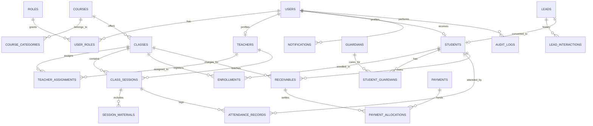

# CH ACADEMY — TÀI LIỆU CƠ SỞ DỮ LIỆU & QUAN HỆ THỰC THỂ (DATABASE SPECIFICATION)

> **Cơ sở dữ liệu:** PostgreSQL 16 (Docker Container `ch_academy_postgres`)  
> **Tên Database:** `ch_academy_db`  
> **Bộ mã ký tự (Encoding):** UTF-8  
> **Công cụ quản lý phiên bản:** Flyway Migration (V1 -> V11)  
> **Tổng số bảng:** 27 bảng nghiệp vụ

---

## 1. SƠ ĐỒ QUAN HỆ THỰC THỂ (ERD DIAGRAM)

---

## 2. LỊCH TRÌNH VÀ NỘI DUNG MIGRATION FLYWAY (V1 ĐẾN V11)

Mọi thay đổi cấu trúc bảng được kiểm soát nghiêm ngặt qua Flyway. Tuyệt đối không can thiệp sửa đổi các migration cũ đã áp dụng vào production/staging; các cải tiến mới được tạo tuần tự qua migration bổ sung:

| Version | Tên Migration Script | Mô tả nghiệp vụ |
|:---:|:---|:---|
| **V1** | `V1__Initial_Schema.sql` | Khởi tạo bảng danh mục khóa học (`categories`), khóa học (`courses`). |
| **V2** | `V2__Create_Security_And_Users.sql` | Khởi tạo bảng người dùng (`users`), vai trò (`roles`), liên kết vai trò (`user_roles`). Tạo tài khoản quản trị mặc định băm BCrypt. |
| **V3** | `V3__Create_Students_And_Guardians.sql` | Khởi tạo bảng học viên (`students`), người giám hộ (`guardians`), quan hệ phụ huynh–học sinh (`student_guardians`). |
| **V4** | `V4__Create_Leads_And_Interactions.sql` | Khởi tạo bảng phễu tuyển sinh (`leads`) và lịch sử tương tác chăm sóc (`lead_interactions`). |
| **V5** | `V5__Create_Classes_And_Schedules.sql` | Khởi tạo giáo viên (`teachers`), phòng học (`classrooms`), lớp học (`classes`), cấu hình lịch (`class_schedule_configs`) và buổi học (`class_sessions`). |
| **V6** | `V6__Create_Attendance_Records.sql` | Khởi tạo bảng điểm danh (`attendance_records`) với ràng buộc duy nhất `(session_id, student_id)` và ghi nhận trạng thái chuyên cần. |
| **V7** | `V7__Create_Finance_And_Tuition.sql` | Khởi tạo các bảng tài chính: khoản phải thu (`receivables`), thanh toán (`payments`), phân bổ thu tiền (`payment_allocations`) và hoàn phí (`refunds`). |
| **V8** | `V8__Add_Foreign_Keys_And_Indexes.sql` | Hoàn thiện khóa ngoại toàn hệ thống, tạo các chỉ mục tìm kiếm và ràng buộc toàn vẹn tham chiếu. |
| **V9** | `V9__Create_Materials_Notifications_And_Raw_Password.sql` | Tạo bảng tài liệu bài học (`session_materials`), trung tâm thông báo (`notifications`), bổ sung trường hiển thị tài khoản học viên cho admin. |
| **V10** | `V10__Create_Audit_Logs_And_Teacher_Assignments.sql` | Tạo bảng phân công đa giáo viên (`teacher_assignments`) và bảng nhật ký kiểm toán thao tác (`audit_logs`). |
| **V11** | `V11__Fix_Vietnamese_Encoding.sql` | Chuẩn hóa bảng mã UTF-8 toàn bộ dữ liệu mẫu trong `class_sessions`, `session_materials`, `notifications`, khắc phục triệt để lỗi hiển thị dấu hỏi `???`. |

---

## 3. TỪ ĐIỂN CÁC BẢNG DỮ LIỆU CHÍNH (DATA DICTIONARY)

### 3.1. Phân hệ Người dùng & Bảo mật (`identity`)
- **`users`:** `id` (BIGSERIAL PK), `username` (VARCHAR 100 UNIQUE), `email` (VARCHAR 150 UNIQUE), `password_hash` (VARCHAR 255), `full_name` (VARCHAR 150), `phone` (VARCHAR 20), `status` (VARCHAR 30), `raw_password` (VARCHAR 255 - dành cho hỗ trợ cấp tài khoản học viên), `created_at`, `updated_at`.
- **`roles`:** `id` (BIGSERIAL PK), `name` (VARCHAR 50 UNIQUE - VD: `SUPER_ADMIN`, `CENTER_ADMIN`, `ACADEMIC_STAFF`, `ADMISSIONS_STAFF`, `ACCOUNTANT`, `TEACHER`, `STUDENT`, `PARENT`), `description` (TEXT).
- **`user_roles`:** `user_id` (FK `users.id`), `role_id` (FK `roles.id`), PK `(user_id, role_id)`.

### 3.2. Phân hệ Học vụ & Giảng dạy (`academic`)
- **`teachers`:** `id` (BIGSERIAL PK), `user_id` (FK `users.id` UNIQUE), `teacher_code` (VARCHAR 50 UNIQUE), `full_name` (VARCHAR 150), `email` (VARCHAR 150), `phone` (VARCHAR 20), `specialization` (VARCHAR 100), `status` (VARCHAR 30).
- **`classes`:** `id` (BIGSERIAL PK), `course_id` (FK `courses.id`), `class_code` (VARCHAR 50 UNIQUE), `class_name` (VARCHAR 150), `primary_teacher_id` (FK `teachers.id`), `classroom_id` (FK `classrooms.id`), `start_date` (DATE), `end_date` (DATE), `max_capacity` (INT), `status` (VARCHAR 30: `PLANNING`, `OPEN`, `IN_PROGRESS`, `COMPLETED`, `CANCELLED`).
- **`teacher_assignments`:** `id` (BIGSERIAL PK), `class_id` (FK `classes.id`), `teacher_id` (FK `teachers.id`), `role` (VARCHAR 50: `PRIMARY`, `ASSISTANT`), `assigned_at` (TIMESTAMP), `status` (VARCHAR 30). Ràng buộc UNIQUE: `(class_id, teacher_id)`.
- **`class_sessions`:** `id` (BIGSERIAL PK), `class_id` (FK `classes.id`), `session_number` (INT), `session_date` (DATE), `start_time` (TIME), `end_time` (TIME), `teacher_id` (FK `teachers.id`), `classroom_id` (FK `classrooms.id`), `topic` (VARCHAR 255), `status` (VARCHAR 30: `SCHEDULED`, `COMPLETED`, `CANCELLED`).
- **`session_materials`:** `id` (BIGSERIAL PK), `session_id` (FK `class_sessions.id`), `title` (VARCHAR 255), `material_type` (VARCHAR 50: `SLIDE`, `EXERCISE`, `DOCUMENT`, `VIDEO`), `file_url` (TEXT), `file_size` (VARCHAR 50), `uploaded_by` (BIGINT), `created_at` (TIMESTAMP).

### 3.3. Phân hệ Học viên & Điểm danh (`student` & `attendance`)
- **`students`:** `id` (BIGSERIAL PK), `user_id` (FK `users.id` UNIQUE), `student_code` (VARCHAR 50 UNIQUE), `full_name` (VARCHAR 150), `date_of_birth` (DATE), `gender` (VARCHAR 20), `email` (VARCHAR 150), `phone` (VARCHAR 20), `status` (VARCHAR 30).
- **`guardians`:** `id` (BIGSERIAL PK), `full_name` (VARCHAR 150), `phone` (VARCHAR 20), `email` (VARCHAR 150), `occupation` (VARCHAR 100), `created_at` (TIMESTAMP).
- **`student_guardians`:** `student_id` (FK `students.id`), `guardian_id` (FK `guardians.id`), `relationship` (VARCHAR 50: `FATHER`, `MOTHER`, `GUARDIAN`), `is_primary` (BOOLEAN), PK `(student_id, guardian_id)`.
- **`enrollments`:** `id` (BIGSERIAL PK), `student_id` (FK `students.id`), `class_id` (FK `classes.id`), `enrollment_date` (DATE), `status` (VARCHAR 30: `ACTIVE`, `DROPPED`, `COMPLETED`), UNIQUE `(student_id, class_id)`.
- **`attendance_records`:** `id` (BIGSERIAL PK), `session_id` (FK `class_sessions.id`), `student_id` (FK `students.id`), `status` (VARCHAR 30: `PRESENT`, `ABSENT`, `LATE`, `EXCUSED`), `notes` (TEXT), `recorded_by` (BIGINT), `recorded_at` (TIMESTAMP), UNIQUE `(session_id, student_id)`.

### 3.4. Phân hệ Tài chính & Học phí (`finance`)
- **`receivables`:** `id` (BIGSERIAL PK), `student_id` (FK `students.id`), `class_id` (FK `classes.id`), `amount` (DECIMAL 12,2), `paid_amount` (DECIMAL 12,2), `due_date` (DATE), `status` (VARCHAR 30: `PENDING`, `PARTIAL`, `PAID`, `OVERDUE`).
- **`payments`:** `id` (BIGSERIAL PK), `student_id` (FK `students.id`), `amount` (DECIMAL 12,2), `payment_date` (TIMESTAMP), `payment_method` (VARCHAR 50: `BANK_TRANSFER`, `CASH`, `CARD`), `transaction_ref` (VARCHAR 100), `notes` (TEXT).
- **`payment_allocations`:** `id` (BIGSERIAL PK), `payment_id` (FK `payments.id`), `receivable_id` (FK `receivables.id`), `amount` (DECIMAL 12,2), `allocated_at` (TIMESTAMP).

### 3.5. Phân hệ Thông báo & Nhật ký kiểm toán (`notification` & `audit`)
- **`notifications`:** `id` (BIGSERIAL PK), `title` (VARCHAR 255), `content` (TEXT), `scope` (VARCHAR 50: `ALL`, `CLASS`, `TEACHERS`, `STUDENTS`, `USER`), `target_id` (BIGINT NULL), `created_by` (BIGINT), `created_at` (TIMESTAMP).
- **`audit_logs`:** `id` (BIGSERIAL PK), `action` (VARCHAR 100), `entity_name` (VARCHAR 100), `entity_id` (VARCHAR 50), `performed_by` (VARCHAR 100), `details` (TEXT), `performed_at` (TIMESTAMP).

---

## 4. RÀNG BUỘC TOÀN VẸN VÀ CHIẾN LƯỢC DỮ LIỆU

1. **Ngăn chặn điểm danh trùng lặp:** Ràng buộc `UNIQUE (session_id, student_id)` trên `attendance_records` đảm bảo 1 học viên không thể có 2 trạng thái trong cùng một buổi học.
2. **Ngăn chặn ghi danh kép:** Ràng buộc `UNIQUE (student_id, class_id)` trên `enrollments`.
3. **Chiến lược xóa dữ liệu (Deletion Strategy):**
   - Với các đối tượng lõi (Khóa học, Lớp, Học viên, Giáo viên): Áp dụng **Soft Delete** (`status = 'INACTIVE' / 'CANCELLED'`).
   - Với hồ sơ tài chính và điểm danh: Nghiêm cấm xóa cứng (Hard Delete) qua cascade; mọi sai sót điều chỉnh phải thông qua nghiệp vụ hoàn phí hoặc sửa trạng thái có lưu vết trong `audit_logs`.
4. **Bảo toàn dữ liệu kiểm thử & vận hành:** Không chạy các lệnh phá hủy (`docker compose down -v` hoặc `DROP DATABASE`) trong quá trình triển khai. Mọi sửa đổi schema luôn được kiểm soát bằng Flyway migration mới.
