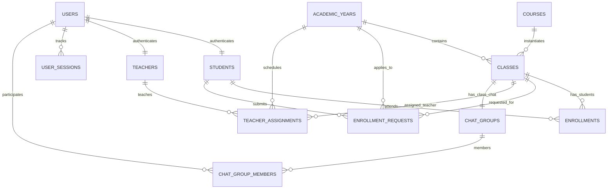

# CH ACADEMY — HỆ SINH THÁI ĐA NĂM HỌC THỐNG NHẤT
## Tài liệu 02: Mô hình Dữ liệu và Cơ sở Dữ liệu Quan hệ (Relational Database Schema)

---

## 1. SƠ ĐỒ THỰC THỂ QUAN HỆ (ERD - ENTITY RELATIONSHIP DIAGRAM)

---

## 2. CHI TIẾT BẢNG VÀ CỘNG NỐI KHÓA NGOẠI

### 2.1. Bảng `academic_years` (Quản lý Năm học)
| Tên cột | Kiểu dữ liệu | Ràng buộc | Ý nghĩa |
| :--- | :--- | :--- | :--- |
| `id` | BIGSERIAL | PRIMARY KEY | Khóa chính tự tăng |
| `code` | VARCHAR(20) | UNIQUE, NOT NULL | Mã năm học (VD: `2026-2027`, `2027-2028`) |
| `name` | VARCHAR(100)| NOT NULL | Tên hiển thị (VD: "Năm học 2026 - 2027") |
| `start_date` | DATE | NOT NULL | Ngày khai giảng năm học |
| `end_date` | DATE | NOT NULL | Ngày bế giảng năm học |
| `registration_start_date` | DATE | NULL | Ngày bắt đầu mở cổng đăng ký trực tuyến |
| `registration_end_date` | DATE | NULL | Hạn chót đóng cổng đăng ký trực tuyến |
| `is_current` | BOOLEAN | DEFAULT FALSE | Cờ xác định năm học hiện hành (duy nhất 1 năm = true) |
| `status` | VARCHAR(20) | DEFAULT 'ACTIVE' | Trạng thái: `PLANNING`, `ACTIVE`, `CLOSED`, `ARCHIVED` |
| `description` | TEXT | NULL | Ghi chú lộ trình học tập và chỉ tiêu tuyển sinh |
| `created_at` / `updated_at` | TIMESTAMPTZ | NOT NULL | Dấu thời gian kiểm toán |

### 2.2. Bảng `enrollment_requests` (Đăng ký khóa học của học viên)
| Tên cột | Kiểu dữ liệu | Ràng buộc | Ý nghĩa |
| :--- | :--- | :--- | :--- |
| `id` | BIGSERIAL | PRIMARY KEY | Khóa chính đơn đăng ký |
| `student_id` | BIGINT | FK -> `students(id)` | Học viên gửi yêu cầu đăng ký |
| `class_id` | BIGINT | FK -> `classes(id)` | Lớp học được chọn |
| `academic_year` | VARCHAR(20)| NOT NULL | Niên khóa của lớp học được đăng ký |
| `status` | VARCHAR(20) | DEFAULT 'PENDING' | Trạng thái: `PENDING`, `APPROVED`, `REJECTED`, `CANCELLED` |
| `notes` | TEXT | NULL | Ghi chú nguyện vọng của học viên khi nộp đơn |
| `reviewed_by` | BIGINT | FK -> `users(id)` | Admin hoặc cán bộ đào tạo thực hiện duyệt |
| `reviewed_at` | TIMESTAMPTZ | NULL | Thời điểm phê duyệt hoặc từ chối |
| `review_notes` | TEXT | NULL | Lý do từ chối hoặc ghi chú học bổng/chính sách |
| `discount_amount` | NUMERIC(12,2)| DEFAULT 0 | Mức chiết khấu/học bổng áp dụng |
| `created_at` / `updated_at` | TIMESTAMPTZ | NOT NULL | Dấu thời gian hệ thống |

**Chỉ mục tối ưu:**
- `idx_enrollment_requests_student` ON `enrollment_requests(student_id)`
- `idx_enrollment_requests_class` ON `enrollment_requests(class_id)`
- `idx_enrollment_requests_status` ON `enrollment_requests(status)`
- `idx_enrollment_requests_year` ON `enrollment_requests(academic_year)`

### 2.3. Bảng `classes` (Liên kết Niên khóa)
- Cột `academic_year` VARCHAR(20) liên kết ngữ nghĩa với `academic_years(code)`.
- Ràng buộc trạng thái: Lớp chỉ cho phép học viên đăng ký khi `status = 'ACTIVE'` hoặc `'UPCOMING'`.
- Thuộc tính học phí: `default_tuition_fee` thừa hưởng từ môn học `courses.default_tuition_fee`.

### 2.4. Bảng `enrollments` (Ghi danh chính thức)
- Đại diện cho việc học viên chính thức theo học tại 1 lớp.
- Ràng buộc duy nhất `unique(student_id, class_id)`: Không thể ghi danh trùng lớp trong cùng thời kỳ.
- Trạng thái: `ACTIVE`, `COMPLETED`, `DROPPED`, `TRANSFERRED`.

### 2.5. Bảng `teacher_assignments` (Phân công Giảng viên)
- Lưu lịch sử và trạng thái giảng dạy: `teacher_id`, `class_id`, `academic_year`, `role` (`PRIMARY`, `ASSISTANT`), `status` (`ASSIGNED`, `IN_PROGRESS`, `COMPLETED`).
- Giúp truy vấn tức thì toàn bộ lịch sử phụ trách lớp của một giảng viên theo nhiều niên khóa liên tiếp.

---

## 3. RÀNG BUỘC TOÀN VẸN VÀ TRANSACTION BOUNDARIES

Khi Admin phê duyệt đơn đăng ký (`POST /api/v1/admin/enrollment-requests/{id}/approve`):
Giao dịch được bọc trong `@Transactional(rollbackFor = Exception.class)` thực thi liên hoàn 3 bước nguyên tử (atomic):
1. Cập nhật `enrollment_requests.status = 'APPROVED'`.
2. Kiểm tra và chèn bản ghi vào bảng `enrollments(student_id, class_id, status='ACTIVE')`.
3. Kiểm tra nhóm chat lớp học (`chat_groups WHERE class_id = ?`): Nếu tồn tại, tự động thêm học viên vào bảng `chat_group_members(chat_group_id, user_id, role='MEMBER')`.
4. Tính toán học phí gốc trừ đi `discount_amount` và khởi tạo bản ghi `receivables` (Công nợ học phí) ghi nhận vào số sách kế toán của năm học.
Nếu bất kỳ bước nào thất bại, toàn bộ thao tác tự động Rollback, đảm bảo không bao giờ xảy ra tình trạng "được vào nhóm chat nhưng chưa có ghi danh" hoặc "có ghi danh nhưng không có công nợ học phí".
