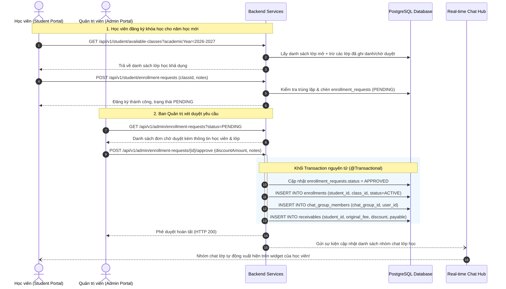

# CH ACADEMY — HỆ SINH THÁI ĐA NĂM HỌC THỐNG NHẤT
## Tài liệu 03: Quy trình Đăng ký Khóa học Xuyên Năm (Course Registration Workflow)

---

## 1. SƠ ĐỒ LUỒNG NGHIỆP VỤ (END-TO-END WORKFLOW)

---

## 2. QUY TẮC NGHIỆP VỤ (BUSINESS RULES)

### 2.1. Điều kiện nộp đơn đăng ký:
1. Học viên đã đăng nhập và có hồ sơ `students` hợp lệ liên kết với tài khoản `users`.
2. Lớp học được chọn phải thuộc năm học đang cho phép đăng ký (`registration_start_date` <= hiện tại <= `registration_end_date`).
3. Học viên không được gửi đơn đăng ký nếu:
   - Đã có bản ghi `enrollments` đang hoạt động trong lớp đó.
   - Đã có đơn đăng ký ở trạng thái `PENDING` cho cùng lớp học đó.
4. Trường `notes` cho phép học viên ghi chú nguyện vọng (VD: xin xếp ca học, nguyện vọng miễn giảm học phí).

### 2.2. Quyền tự hủy đơn của học viên:
- Học viên có quyền hủy đơn đăng ký của mình (`DELETE /api/v1/student/enrollment-requests/{id}`) **khi và chỉ khi** đơn đó vẫn ở trạng thái `PENDING`.
- Nếu đơn đã được duyệt (`APPROVED`) hoặc đã bị từ chối (`REJECTED`), học viên không thể tự hủy qua API mà phải gửi yêu cầu lên phòng Đào tạo.

### 2.3. Quy trình phê duyệt & Từ chối của Quản trị viên:
- **Phê duyệt (`APPROVE`)**:
  - Admin có thể điền mức chiết khấu (`discount_amount`) nếu học viên thuộc diện chính sách, con em gia đình khó khăn hoặc có học bổng.
  - Số tiền phải nộp được tính tự động: `Số tiền = Học phí lớp - Mức giảm`.
  - Tự động đồng bộ quyền thành viên nhóm chat của lớp học: Học viên ngay lập tức có thể trao đổi với giáo viên và các bạn cùng lớp.
- **Từ chối (`REJECT`)**:
  - Bắt buộc phải có lý do từ chối (`review_notes`) để học viên nắm rõ (VD: "Lớp học đã đủ sĩ số tối đa", "Học viên chưa đạt điều kiện tiên quyết của môn học").
  - Trạng thái chuyển thành `REJECTED`, không tạo `enrollment` và không tạo nhóm chat.

---

## 3. GIAO DIỆN VÀ TRẢI NGHIỆM NGƯỜI DÙNG (UX IMPLEMENTATION)

1. **Trên Student Portal (`/student` -> Tab "Đăng ký Khóa học Mới")**:
   - Bộ lọc theo năm học tự động lấy năm học hiện tại.
   - Danh sách thẻ bài giảng hiển thị rõ ràng: Tên khóa học, Mã lớp, Giáo viên phụ trách, Lịch học trong tuần, Học phí niêm yết, và Số chỗ còn trống.
   - Nút "Đăng ký ngay" mở form nhập nguyện vọng và xác nhận.
   - Bảng "Lịch sử đơn đăng ký" hiển thị trạng thái động bằng Badge màu sắc: Vàng (`PENDING`), Xanh lá (`APPROVED`), Đỏ (`REJECTED`), Xám (`CANCELLED`).

2. **Trên Admin Portal (`/admin/enrollment-requests`)**:
   - Thống kê thời gian thực: Tổng đơn chờ duyệt, Tổng đơn đã duyệt, Tổng đơn từ chối.
   - Hỗ trợ lọc theo trạng thái và tìm kiếm theo tên học viên, mã lớp học.
   - Modal phê duyệt cho phép nhập chiết khấu học phí và ghi chú duyệt, hiển thị ngay học phí sau chiết khấu trước khi ấn xác nhận.
