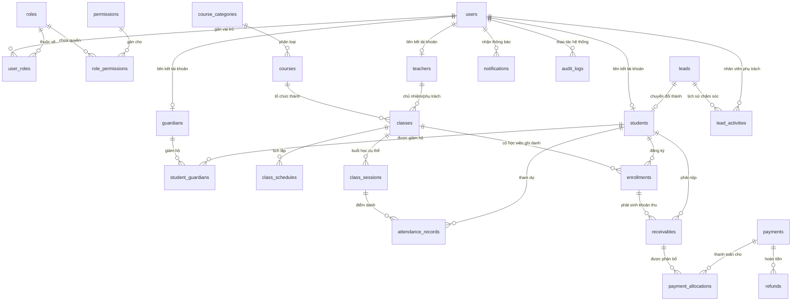

# Thiết Kế Cơ Sở Dữ Liệu - CH Academy

> **Hệ quản trị CSDL:** PostgreSQL 16  
> **Quản lý phiên bản Schema:** Flyway Migrations (bắt đầu từ V2)  
> **Múi giờ lưu trữ:** UTC timestamp with time zone (`TIMESTAMPTZ`)  
> **Quy ước tiền tệ:** `NUMERIC(15, 2)` (tuyệt đối không dùng float/double)

---

## 1. Sơ đồ Thực thể Quan hệ (ERD - Mermaid)

---

## 2. Danh Sách Các Bảng & Cấu Trúc Chi Tiết

### Nhóm 1: Xác thực & Phân quyền (Security & Identity)
1. **`roles`**:
   - `id` (VARCHAR(30) PRIMARY KEY) - e.g. `SUPER_ADMIN`, `CENTER_ADMIN`, `ADMISSIONS_STAFF`, `ACADEMIC_STAFF`, `ACCOUNTANT`, `TEACHER`, `STUDENT`, `PARENT`
   - `name` (VARCHAR(100) NOT NULL)
   - `description` (TEXT)
   - `is_system` (BOOLEAN DEFAULT TRUE)
2. **`permissions`**:
   - `id` (VARCHAR(50) PRIMARY KEY) - e.g. `course:read`, `course:write`, `student:read`, `student:write`, `finance:read`, `finance:write`, `attendance:write`, v.v.
   - `module` (VARCHAR(50) NOT NULL)
   - `description` (TEXT)
3. **`role_permissions`**:
   - `role_id` (VARCHAR(30) REFERENCES roles(id) ON DELETE CASCADE)
   - `permission_id` (VARCHAR(50) REFERENCES permissions(id) ON DELETE CASCADE)
   - PRIMARY KEY (`role_id`, `permission_id`)
4. **`users`**:
   - `id` (BIGSERIAL PRIMARY KEY)
   - `username` (VARCHAR(50) UNIQUE NOT NULL)
   - `password_hash` (VARCHAR(255) NOT NULL) - BCrypt/Argon2
   - `full_name` (VARCHAR(150) NOT NULL)
   - `email` (VARCHAR(100) UNIQUE)
   - `phone` (VARCHAR(20) UNIQUE)
   - `status` (VARCHAR(20) NOT NULL DEFAULT 'ACTIVE') - `ACTIVE`, `INACTIVE`, `LOCKED`
   - `avatar_url` (VARCHAR(255))
   - `last_login_at` (TIMESTAMPTZ)
   - `created_at` (TIMESTAMPTZ NOT NULL DEFAULT CURRENT_TIMESTAMP)
   - `updated_at` (TIMESTAMPTZ NOT NULL DEFAULT CURRENT_TIMESTAMP)
5. **`user_roles`**:
   - `user_id` (BIGINT REFERENCES users(id) ON DELETE CASCADE)
   - `role_id` (VARCHAR(30) REFERENCES roles(id) ON DELETE CASCADE)
   - PRIMARY KEY (`user_id`, `role_id`)

### Nhóm 2: Khóa học & Đào tạo (Courses)
6. **`course_categories`**:
   - `id` (BIGSERIAL PRIMARY KEY)
   - `code` (VARCHAR(30) UNIQUE NOT NULL)
   - `name` (VARCHAR(100) NOT NULL)
   - `description` (TEXT)
   - `is_active` (BOOLEAN DEFAULT TRUE)
   - `created_at`, `updated_at`
7. **`courses`**:
   - `id` (BIGSERIAL PRIMARY KEY)
   - `category_id` (BIGINT REFERENCES course_categories(id))
   - `code` (VARCHAR(30) UNIQUE NOT NULL) - e.g. `ENG-KIDS-01`, `PROG-PY-01`
   - `name` (VARCHAR(200) NOT NULL)
   - `description` (TEXT)
   - `target_audience` (VARCHAR(100)) - 'KIDS', 'TEENS', 'ADULTS', 'ALL'
   - `duration_hours` (INT NOT NULL DEFAULT 30)
   - `default_tuition_fee` (NUMERIC(15, 2) NOT NULL DEFAULT 0.00)
   - `learning_outcomes` (TEXT)
   - `status` (VARCHAR(20) DEFAULT 'ACTIVE') - `DRAFT`, `ACTIVE`, `SUSPENDED`, `ARCHIVED`
   - `is_public` (BOOLEAN DEFAULT TRUE) - hiển thị ngoài website
   - `created_at`, `updated_at`

### Nhóm 3: Nhân sự & Giáo viên (Teachers & Staff)
8. **`teachers`**:
   - `id` (BIGSERIAL PRIMARY KEY)
   - `user_id` (BIGINT UNIQUE REFERENCES users(id) ON DELETE SET NULL)
   - `teacher_code` (VARCHAR(30) UNIQUE NOT NULL)
   - `full_name` (VARCHAR(150) NOT NULL)
   - `email` (VARCHAR(100))
   - `phone` (VARCHAR(20))
   - `specialization` (VARCHAR(255)) - Chuyên môn
   - `bio` (TEXT)
   - `status` (VARCHAR(20) DEFAULT 'ACTIVE') - `ACTIVE`, `ON_LEAVE`, `RESIGNED`
   - `created_at`, `updated_at`

### Nhóm 4: Học viên & Người giám hộ (Students & Guardians)
9. **`guardians`**:
   - `id` (BIGSERIAL PRIMARY KEY)
   - `user_id` (BIGINT UNIQUE REFERENCES users(id) ON DELETE SET NULL)
   - `full_name` (VARCHAR(150) NOT NULL)
   - `phone` (VARCHAR(20) NOT NULL)
   - `email` (VARCHAR(100))
   - `address` (TEXT)
   - `occupation` (VARCHAR(100))
   - `created_at`, `updated_at`
10. **`students`**:
    - `id` (BIGSERIAL PRIMARY KEY)
    - `user_id` (BIGINT UNIQUE REFERENCES users(id) ON DELETE SET NULL)
    - `student_code` (VARCHAR(30) UNIQUE NOT NULL) - e.g. `HV20240001`
    - `full_name` (VARCHAR(150) NOT NULL)
    - `date_of_birth` (DATE)
    - `gender` (VARCHAR(10)) - 'MALE', 'FEMALE', 'OTHER'
    - `phone` (VARCHAR(20))
    - `email` (VARCHAR(100))
    - `address` (TEXT)
    - `target_type` (VARCHAR(20) DEFAULT 'ADULT') - 'KID', 'ADULT'
    - `status` (VARCHAR(20) DEFAULT 'ACTIVE') - `ACTIVE`, `INACTIVE`, `GRADUATED`, `DROPPED`
    - `internal_notes` (TEXT)
    - `created_at`, `updated_at`
11. **`student_guardians`**:
    - `student_id` (BIGINT REFERENCES students(id) ON DELETE CASCADE)
    - `guardian_id` (BIGINT REFERENCES guardians(id) ON DELETE CASCADE)
    - `relationship_type` (VARCHAR(30) NOT NULL) - 'FATHER', 'MOTHER', 'OTHER'
    - `is_primary_contact` (BOOLEAN DEFAULT FALSE)
    - PRIMARY KEY (`student_id`, `guardian_id`)

### Nhóm 5: Tuyển sinh & Khách hàng tiềm năng (Leads)
12. **`leads`**:
    - `id` (BIGSERIAL PRIMARY KEY)
    - `full_name` (VARCHAR(150) NOT NULL)
    - `phone` (VARCHAR(20) NOT NULL)
    - `email` (VARCHAR(100))
    - `source` (VARCHAR(50) DEFAULT 'WEBSITE') - 'WEBSITE', 'FACEBOOK', 'REFERRAL', 'WALK_IN'
    - `target_course_id` (BIGINT REFERENCES courses(id))
    - `assigned_staff_id` (BIGINT REFERENCES users(id))
    - `status` (VARCHAR(20) DEFAULT 'NEW') - `NEW`, `CONTACTED`, `CONSULTING`, `APPOINTMENT`, `CONVERTED`, `LOST`
    - `notes` (TEXT)
    - `converted_student_id` (BIGINT REFERENCES students(id))
    - `created_at`, `updated_at`
13. **`lead_activities`**:
    - `id` (BIGSERIAL PRIMARY KEY)
    - `lead_id` (BIGINT REFERENCES leads(id) ON DELETE CASCADE)
    - `staff_id` (BIGINT REFERENCES users(id))
    - `action_type` (VARCHAR(50) NOT NULL) - 'CALL', 'MESSAGE', 'MEETING', 'NOTE'
    - `content` (TEXT NOT NULL)
    - `next_appointment_at` (TIMESTAMPTZ)
    - `created_at` (TIMESTAMPTZ DEFAULT CURRENT_TIMESTAMP)

### Nhóm 6: Lớp học, Lịch học & Ghi danh (Classes & Enrollments)
14. **`classes`**:
    - `id` (BIGSERIAL PRIMARY KEY)
    - `course_id` (BIGINT NOT NULL REFERENCES courses(id))
    - `primary_teacher_id` (BIGINT REFERENCES teachers(id))
    - `code` (VARCHAR(30) UNIQUE NOT NULL) - e.g. `CLS-ENG-01`
    - `name` (VARCHAR(150) NOT NULL)
    - `max_capacity` (INT NOT NULL DEFAULT 15)
    - `room` (VARCHAR(50))
    - `start_date` (DATE NOT NULL)
    - `end_date` (DATE)
    - `status` (VARCHAR(20) DEFAULT 'PLANNING') - `PLANNING`, 'OPEN_FOR_ENROLLMENT', `IN_PROGRESS`, `COMPLETED`, `CANCELLED`
    - `created_at`, `updated_at`
15. **`class_schedules`**:
    - `id` (BIGSERIAL PRIMARY KEY)
    - `class_id` (BIGINT REFERENCES classes(id) ON DELETE CASCADE)
    - `day_of_week` (INT NOT NULL) - 1: Thứ 2, 2: Thứ 3, ..., 7: Chủ Nhật
    - `start_time` (TIME NOT NULL)
    - `end_time` (TIME NOT NULL)
    - `room` (VARCHAR(50))
16. **`class_sessions`**: (Các buổi học cụ thể)
    - `id` (BIGSERIAL PRIMARY KEY)
    - `class_id` (BIGINT REFERENCES classes(id) ON DELETE CASCADE)
    - `teacher_id` (BIGINT REFERENCES teachers(id))
    - `session_date` (DATE NOT NULL)
    - `start_time` (TIME NOT NULL)
    - `end_time` (TIME NOT NULL)
    - `room` (VARCHAR(50))
    - `topic` (VARCHAR(255))
    - `status` (VARCHAR(20) DEFAULT 'SCHEDULED') - `SCHEDULED`, `COMPLETED`, `CANCELLED`, `RESCHEDULED`
    - `created_at`, `updated_at`
17. **`enrollments`**:
    - `id` (BIGSERIAL PRIMARY KEY)
    - `class_id` (BIGINT NOT NULL REFERENCES classes(id))
    - `student_id` (BIGINT NOT NULL REFERENCES students(id))
    - `enrollment_date` (DATE NOT NULL DEFAULT CURRENT_DATE)
    - `applied_tuition_fee` (NUMERIC(15, 2) NOT NULL)
    - `discount_amount` (NUMERIC(15, 2) DEFAULT 0.00)
    - `final_fee` (NUMERIC(15, 2) NOT NULL)
    - `status` (VARCHAR(20) DEFAULT 'ENROLLED') - `ENROLLED`, `DROPPED`, `COMPLETED`
    - `notes` (TEXT)
    - `created_at`, `updated_at`
    - UNIQUE (`class_id`, `student_id`)

### Nhóm 7: Điểm danh (Attendance)
18. **`attendance_records`**:
    - `id` (BIGSERIAL PRIMARY KEY)
    - `session_id` (BIGINT NOT NULL REFERENCES class_sessions(id) ON DELETE CASCADE)
    - `student_id` (BIGINT NOT NULL REFERENCES students(id) ON DELETE CASCADE)
    - `status` (VARCHAR(20) NOT NULL) - 'PRESENT', 'ABSENT', 'LATE', 'EXCUSED'
    - `note` (TEXT)
    - `recorded_by` (BIGINT REFERENCES users(id))
    - `recorded_at` (TIMESTAMPTZ DEFAULT CURRENT_TIMESTAMP)
    - `updated_at` (TIMESTAMPTZ DEFAULT CURRENT_TIMESTAMP)
    - UNIQUE (`session_id`, `student_id`)

### Nhóm 8: Tài chính & Học phí (Finance)
19. **`receivables`** (Khoản phải thu):
    - `id` (BIGSERIAL PRIMARY KEY)
    - `code` (VARCHAR(50) UNIQUE NOT NULL) - e.g. `REC-2024-0001`
    - `enrollment_id` (BIGINT REFERENCES enrollments(id))
    - `student_id` (BIGINT NOT NULL REFERENCES students(id))
    - `title` (VARCHAR(255) NOT NULL)
    - `amount` (NUMERIC(15, 2) NOT NULL)
    - `paid_amount` (NUMERIC(15, 2) NOT NULL DEFAULT 0.00)
    - `due_date` (DATE NOT NULL)
    - `status` (VARCHAR(20) DEFAULT 'PENDING') - `PENDING`, `PARTIALLY_PAID`, `PAID`, `CANCELLED`
    - `created_at`, `updated_at`
20. **`payments`** (Giao dịch thu tiền):
    - `id` (BIGSERIAL PRIMARY KEY)
    - `transaction_code` (VARCHAR(50) UNIQUE NOT NULL) - e.g. `PAY-2024-0001`
    - `student_id` (BIGINT NOT NULL REFERENCES students(id))
    - `amount` (NUMERIC(15, 2) NOT NULL)
    - `payment_method` (VARCHAR(30) NOT NULL) - 'CASH', 'BANK_TRANSFER', 'CARD'
    - `paid_at` (TIMESTAMPTZ NOT NULL DEFAULT CURRENT_TIMESTAMP)
    - `received_by` (BIGINT REFERENCES users(id))
    - `note` (TEXT)
    - `status` (VARCHAR(20) DEFAULT 'SUCCESS') - `SUCCESS`, `CANCELLED`
    - `created_at` (TIMESTAMPTZ DEFAULT CURRENT_TIMESTAMP)
21. **`payment_allocations`** (Phân bổ thanh toán cho từng khoản phải thu):
    - `id` (BIGSERIAL PRIMARY KEY)
    - `payment_id` (BIGINT NOT NULL REFERENCES payments(id))
    - `receivable_id` (BIGINT NOT NULL REFERENCES receivables(id))
    - `allocated_amount` (NUMERIC(15, 2) NOT NULL)
    - `created_at` (TIMESTAMPTZ DEFAULT CURRENT_TIMESTAMP)
22. **`refunds`** (Hoàn tiền):
    - `id` (BIGSERIAL PRIMARY KEY)
    - `refund_code` (VARCHAR(50) UNIQUE NOT NULL)
    - `payment_id` (BIGINT REFERENCES payments(id))
    - `amount` (NUMERIC(15, 2) NOT NULL)
    - `reason` (TEXT NOT NULL)
    - `approved_by` (BIGINT REFERENCES users(id))
    - `created_at` (TIMESTAMPTZ DEFAULT CURRENT_TIMESTAMP)

### Nhóm 9: Hệ thống, Thông báo & Audit (Core)
23. **`notifications`**:
    - `id` (BIGSERIAL PRIMARY KEY)
    - `user_id` (BIGINT NOT NULL REFERENCES users(id) ON DELETE CASCADE)
    - `title` (VARCHAR(200) NOT NULL)
    - `content` (TEXT NOT NULL)
    - `type` (VARCHAR(50) DEFAULT 'SYSTEM')
    - `is_read` (BOOLEAN DEFAULT FALSE)
    - `created_at` (TIMESTAMPTZ DEFAULT CURRENT_TIMESTAMP)
24. **`audit_logs`**:
    - `id` (BIGSERIAL PRIMARY KEY)
    - `user_id` (BIGINT REFERENCES users(id))
    - `action` (VARCHAR(100) NOT NULL)
    - `entity_name` (VARCHAR(100) NOT NULL)
    - `entity_id` (VARCHAR(100))
    - `details` (TEXT)
    - `ip_address` (VARCHAR(50))
    - `created_at` (TIMESTAMPTZ DEFAULT CURRENT_TIMESTAMP)
25. **`center_settings`**:
    - `id` (BIGSERIAL PRIMARY KEY)
    - `setting_key` (VARCHAR(100) UNIQUE NOT NULL)
    - `setting_value` (TEXT)
    - `description` (TEXT)
    - `updated_at` (TIMESTAMPTZ DEFAULT CURRENT_TIMESTAMP)

---

## 3. Chiến lược Flyway Migrations

- **`V1__Initial_Schema.sql`**: (Đã áp dụng - tạo `system_info`)
- **`V2__Create_Security_And_Users.sql`**: Tạo roles, permissions, role_permissions, users, user_roles và seed default roles/admin user.
- **`V3__Create_Courses_And_Categories.sql`**: Tạo course_categories, courses.
- **`V4__Create_Students_Guardians_Teachers.sql`**: Tạo teachers, guardians, students, student_guardians.
- **`V5__Create_Leads_And_Admissions.sql`**: Tạo leads, lead_activities.
- **`V6__Create_Classes_Schedules_Enrollments.sql`**: Tạo classes, class_schedules, class_sessions, enrollments.
- **`V7__Create_Attendance.sql`**: Tạo attendance_records.
- **`V8__Create_Finance_And_Payments.sql`**: Tạo receivables, payments, payment_allocations, refunds.
- **`V9__Create_Core_Notifications_Audit_Settings.sql`**: Tạo notifications, audit_logs, center_settings.
