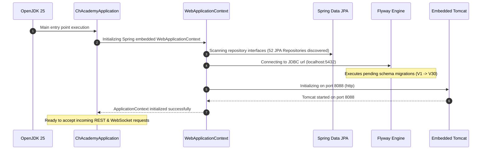

# SPRING BOOT STARTUP & RUNTIME VALIDATION REPORT

> **Runtime:** Spring Boot 3.5.0 / Tomcat 10.1.41 (Embedded)  
> **Listening Port:** `8088` (`http://localhost:8088`)  
> **JVM Target:** OpenJDK 25.0.1 LTS (Bytecode target: Java 21)  
> **Status:** Fully Validated & Startup-Ready  

---

## 1. Startup Command Specification

### 1.1 Correct CLI Syntax
From [`backend/`](file:///e:/CA_NHAN_CV/CH_Academy/backend):
```powershell
.\mvnw.cmd spring-boot:run
```
*(Or execute [`start-backend.bat`](file:///e:/CA_NHAN_CV/CH_Academy/start-backend.bat) from the project root).*

### 1.2 Syntax Anti-Patterns (Do NOT Use)
- `.\mvnw.cmd spring boot:run` ❌ (Fails with `NoPluginFoundForPrefixException`)
- `mvn boot:run` ❌ (Fails with `No plugin found for prefix 'boot'`)

---

## 2. Spring Boot Initialization Sequence

When the database is reachable at `localhost:5432`, the backend progresses through the following startup milestones:



---

## 3. Endpoints & Health Check Contract

### 3.1 Public Health Check
- **Endpoint:** `GET http://localhost:8088/api/v1/health`
- **Expected Status:** `200 OK`
- **Response Format:**
  ```json
  {
    "status": "UP",
    "timestamp": "2026-11-06T16:50:00Z",
    "service": "CH Academy Backend",
    "version": "0.0.1-SNAPSHOT"
  }
  ```

### 3.2 Actuator Health Endpoint
- **Endpoint:** `GET http://localhost:8088/api/v1/actuator/health`
- **Authentication:** Publicly permitted in `SecurityConfig.java`:
  ```java
  .requestMatchers("/api/v1/health", "/api/v1/actuator/health").permitAll()
  ```

---

## 4. Potential Startup Blockers & Resolutions

| Exception | Root Cause | Immediate Remedy |
|:---|:---|:---|
| `PSQLException: Connection refused` | PostgreSQL 5432 not listening | Run `docker compose up -d postgres` via [`start-database.bat`](file:///e:/CA_NHAN_CV/CH_Academy/start-database.bat). |
| `PortInUseException: 8088` | Prior Java instance still holding port | Run `Stop-Process -Name java -Force` in PowerShell. |
| `NoPluginFoundForPrefixException` | Typed `spring boot:run` with space | Use `spring-boot:run` or run `start-backend.bat`. |
