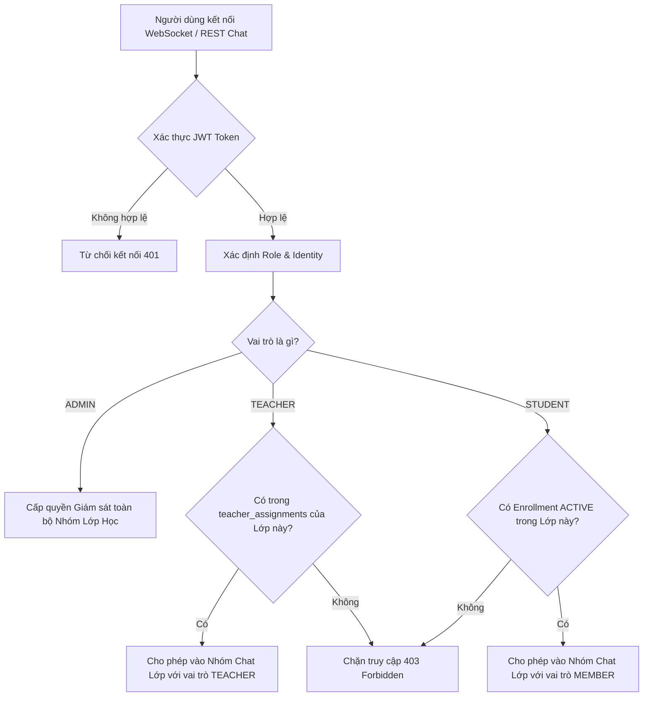

# CH ACADEMY — HỆ THỐNG AN NINH THÔNG TIN TOÀN DIỆN
## Tài liệu 07: Cô lập Nhóm Chat và An ninh Thời gian thực (Chat & Real-time Messaging Isolation)

---

## 1. NGUY CƠ TRUY CẬP TRÁI PHÉP NHÓM CHAT LỚP HỌC

Trước đây, hệ thống gặp lỗi logic nghiệp vụ: Học viên chỉ đăng ký 1 lớp học nhưng giao diện lại cho phép truy cập 2 nhóm chat, hoặc quản trị viên mở widget chat lại hiện thông báo "Chưa có nhóm lớp học".

**Nguyên nhân gốc rễ**:
- Thiếu sự đồng bộ chặt chẽ giữa bảng ghi danh học tập (`enrollments`) và bảng thành viên nhóm chat (`chat_group_members`).
- Client tự ý hiển thị các kênh chat mà không dựa trên quyền phân bổ Backend thực tế.

---

## 2. GIẢI PHÁP CÔ LẬP TOÀN DIỆN (COMPREHENSIVE ISOLATION MODEL)

### 2.1. Quy tắc ràng buộc thành viên nhóm chat:
1. **Đối với Học viên**: Chỉ được tham gia nhóm chat khi có bản ghi `enrollments` hợp lệ ở trạng thái `ACTIVE`. Khi học viên bảo lưu hoặc chuyển lớp, hệ thống tự động thu hồi quyền trong nhóm cũ.
2. **Đối với Giảng viên**: Chỉ được tham gia nhóm chat khi có phân công giảng dạy `teacher_assignments` đang hiệu lực.
3. **Đối với Quản trị viên**: Được cấp chế độ "Giám sát Chat Nhóm Lớp (ADMIN)" để kiểm tra chất lượng giảng dạy và hỗ trợ xử lý sự cố mà không cần ghi danh giả làm học sinh.

### 2.2. Kiểm soát truyền phát tin nhắn (STOMP Channel Authorization):
- Kênh `/topic/class.{classId}` được bảo vệ bởi Interceptor kiểm tra `classId` trước khi chuyển phát tin nhắn. Kẻ xấu không thể giả mạo `senderId` vì `senderId` được ép cố định từ Principal đã xác thực trên WebSocket session.
