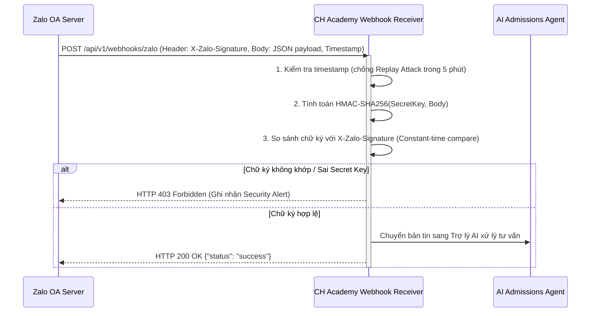

# CH ACADEMY — HỆ THỐNG AN NINH THÔNG TIN TOÀN DIỆN
## Tài liệu 13: An ninh Tích hợp Zalo Official Account và Webhook (Zalo OA & Webhook Security)

---

## 1. NGUY CƠ GIẢ MẠO WEBHOOK (WEBHOOK SPOOFING & REPLAY ATTACK)

Webhook endpoint `/api/v1/webhooks/zalo` là điểm tiếp nhận bản tin sự kiện nhắn tin từ nền tảng Zalo OA. Nếu không có cơ chế bảo vệ:
- Kẻ tấn công có thể gửi các bản tin giả mạo người dùng nhằm lừa đảo trợ lý AI, trích xuất dữ liệu hoặc tạo lead ảo trong hệ thống CRM.
- Tấn công gửi lại tin nhắn cũ (Replay Attack) gây quá tải xử lý.

---

## 2. CƠ CHẾ XÁC THỰC VÀ BẢO VỆ CHỮ KÝ HMAC-SHA256

### Các biện pháp đã triển khai:
1. **Xác thực chữ ký số HMAC-SHA256**: Mọi gói tin webhook đều được kiểm tra chữ ký với `ZALO_APP_SECRET`. Nếu thiếu chữ ký hoặc chữ ký không khớp, hệ thống từ chối xử lý ngay lập tức.
2. **So sánh thời gian hằng số (Constant-time comparison)**: Sử dụng `MessageDigest.isEqual()` để so sánh chuỗi băm, ngăn ngừa tấn công phân tích thời gian (Timing Attacks).
3. **Chống Replay Attack**: Gói tin có thời gian phát sinh lệch quá 5 phút so với đồng hồ máy chủ sẽ bị loại bỏ.
