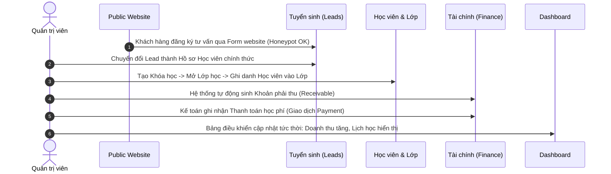

# CH Academy — Hướng Dẫn Kiểm Thử (Testing Guide)

Tài liệu hướng dẫn thực thi kiểm thử tự động toàn diện cho hệ thống **CH Academy**, bao gồm Backend Unit & Integration Tests, Frontend Vitest & React Testing Library, và Luồng kiểm thử tích hợp End-to-End (E2E).

---

## 1. Tổng Quan Kết Quả Kiểm Thử

| Phân hệ | Khung kiểm thử | Số lượng bài test | Trạng thái |
|---|---|---|---|
| **Backend** | JUnit 5 + Spring Boot Test + MockMvc | **33 / 33 tests** | ✅ **100% PASS** |
| **Frontend** | Vitest + React Testing Library + jsdom | **32 / 32 tests** (10 suites) | ✅ **100% PASS** |
| **Build Production** | TypeScript compiler + Vite bundler | `tsc -b && vite build` | ✅ **SUCCESS (0 errors)** |

---

## 2. Kiểm Thử Backend (Java Spring Boot)

### 2.1 Các bộ kiểm thử chính
1. `ChAcademyApplicationTests`: Kiểm tra ngữ cảnh ứng dụng (Application Context load) & Actuator/Health endpoint.
2. `AuthControllerTest`: Kiểm tra luồng xác thực, đăng nhập tài khoản hợp lệ, chặn mật khẩu sai, cấp phát token JWT và API `/me`.
3. `CourseControllerTest`: Kiểm tra CRUD khóa học, danh mục, phân trang, lọc tìm kiếm, validation mã khóa học trùng lặp.
4. `StudentControllerTest`: Kiểm tra tạo hồ sơ học viên, liên kết người giám hộ, validation trùng số điện thoại/mã học viên.
5. `LeadControllerTest`: Kiểm tra tiếp nhận khách hàng tiềm năng, chuyển đổi lead thành học viên nguyên tử (`atomic transaction`).
6. `ClassControllerTest`: Kiểm tra tạo lớp học, kiểm tra xung đột lịch dạy của giáo viên, xung đột phòng học, giới hạn sĩ số.
7. `AttendanceControllerTest`: Kiểm tra điểm danh học viên theo buổi học, cập nhật trạng thái (`PRESENT`, `ABSENT`, `LATE`, `EXCUSED`), kiểm tra trùng bản ghi điểm danh.
8. `FinanceControllerTest`: Kiểm tra tạo khoản phải thu (`Receivable`), ghi nhận thanh toán (`Payment`), phân bổ công nợ FIFO, chống ghi nhận trùng lặp, xử lý hoàn phí (`Refund`).
9. `DashboardControllerTest`: Kiểm tra trích xuất số liệu thống kê tổng quan (học viên, khóa học, doanh thu, công nợ, lịch học sắp tới) và kiểm tra phân quyền truy cập.

### 2.2 Câu lệnh chạy kiểm thử Backend
Từ thư mục `backend/`:
```powershell
# Chạy toàn bộ 33 bài test backend
.\mvnw.cmd test

# Chạy riêng một bài test cụ thể
.\mvnw.cmd test -Dtest=DashboardControllerTest
.\mvnw.cmd test -Dtest=FinanceControllerTest
```

---

## 3. Kiểm Thử Frontend (React + TypeScript)

### 3.1 Các bộ kiểm thử chính
1. `App.test.tsx`: Kiểm tra thanh điều hướng chính, logo, nhận diện thương hiệu, kết nối backend health check.
2. `LoginPage.test.tsx`: Kiểm tra biểu mẫu đăng nhập, validation form rỗng, tích hợp API đăng nhập và lưu trữ token.
3. `DashboardPage.test.tsx`: Kiểm tra hiển thị thẻ thống kê số liệu thực, thẻ tài chính, bảng lịch học sắp tới và trạng thái rỗng.
4. `CourseListPage.test.tsx`: Kiểm tra danh sách khóa học, tìm kiếm, lọc danh mục, mở modal tạo khóa học mới.
5. `StudentListPage.test.tsx`: Kiểm tra hiển thị học viên, thông tin người giám hộ liên kết, modal thêm học viên.
6. `LeadListPage.test.tsx`: Kiểm tra bảng tuyển sinh, lọc nguồn khách hàng, modal thêm lead tư vấn.
7. `ClassListPage.test.tsx`: Kiểm tra danh sách lớp học, phòng học, giáo viên phụ trách, lịch học định kỳ trong tuần.
8. `AttendancePage.test.tsx`: Kiểm tra giao diện điểm danh theo lớp và buổi học, chuyển đổi trạng thái điểm danh tức thời.
9. `FinancePage.test.tsx`: Kiểm tra hiển thị tổng quan tài chính, danh sách khoản phải thu, lịch sử giao dịch và modal thanh toán.

### 3.2 Câu lệnh chạy kiểm thử Frontend
Từ thư mục `frontend/`:
```powershell
# Chạy toàn bộ 32 bài test tự động (chế độ single-run)
npm run test -- --run

# Chạy kiểm thử ở chế độ theo dõi thay đổi (watch mode)
npm run test

# Kiểm tra kiểu TypeScript và build production
npm run build
```

---

## 4. Kịch Bản Kiểm Thử Tích Hợp End-to-End (E2E Workflow)

Luồng kiểm thử nghiệp vụ xuyên suốt trung tâm đã được xác minh:

