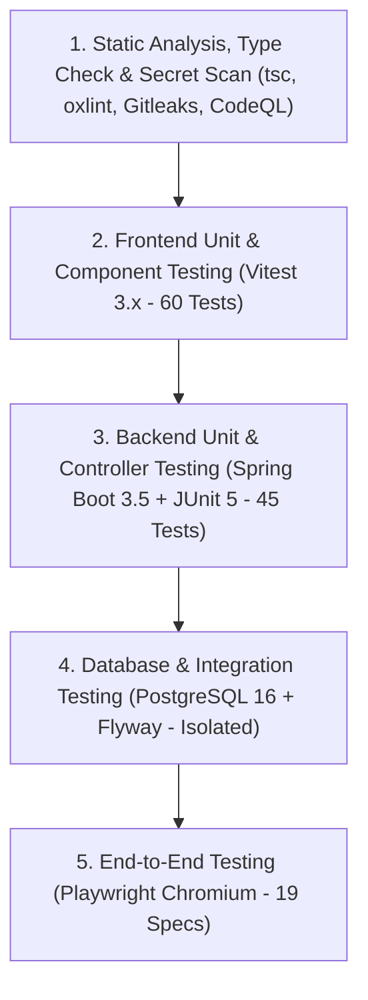

# CHIẾN LƯỢC KIỂM THỬ TỰ ĐỘNG CH ACADEMY (TESTING STRATEGY)

## 1. Giới thiệu và Mục tiêu tổng quan

Hệ thống **CH Academy** là nền tảng quản lý trung tâm học thuật tích hợp AI (AI Agent Studio, Voice Conversation, RAG Knowledge Base, Quản lý đa niên khóa, Quản lý tài chính và Trung tâm An ninh Zero-Trust).

Tài liệu này xác định kiến trúc kiểm thử tự động toàn diện, tích hợp trực tiếp với GitHub Repository `huycuong05112005-star/CH-Academy`, áp dụng mô hình Kim tự tháp kiểm thử (Test Pyramid) tiêu chuẩn công nghiệp nhằm đảm bảo độ tin cậy, an toàn thông tin và tính ổn định cao nhất trước mỗi lần release.

---

## 2. Kim tự tháp kiểm thử (Testing Pyramid)

### 2.1. Lớp 1: Static Code Analysis, Linter & Secret Scanning
- **Frontend Type Checking:** `tsc -b --noEmit` bảo đảm 100% Type-safety cho React 19 + TypeScript.
- **Frontend Linter:** `oxlint` quét các lỗi cú pháp, anti-pattern, dead code.
- **Backend Compiler:** Maven Java 21 compilation với cờ strict type, annotation processing (Lombok, MapStruct).
- **Secret Scanning:** `gitleaks` chặn triệt để lộ lọt Private Key, JWT Secret, Token lên repository.

### 2.2. Lớp 2: Frontend Unit & Component Testing
- **Framework:** Vitest 3.x + `@testing-library/react`.
- **Phạm vi kiểm tra:**
  - Logic tính toán học phí, công nợ, phân trang, lọc học viên.
  - State management (`authStore`, `themeStore`, `notificationStore`).
  - Validation các form nhập liệu: Đăng nhập, Ghi danh, Tạo bài tập, Cấu hình AI Agent.
  - Component rendering: Button, Modal, Card, Table, EmptyState, Theme toggle.
- **Số lượng hiện tại:** 60/60 tests PASSED.

### 2.3. Lớp 3: Backend Unit, Service & Controller Testing
- **Framework:** JUnit 5, Mockito, Spring Boot Test (`@WebMvcTest`, `@ExtendWith(MockitoExtension.class)`).
- **Phạm vi kiểm tra:**
  - `JwtTokenProvider`, `CustomUserDetailsService`: Tạo token, kiểm tra hạn dùng, trích xuất Claims.
  - `DashboardService`: Tính toán thống kê theo từng Niên khóa (`academicYear`) độc lập.
  - `StudentService`, `CourseService`, `ClassService`: Nghiệp vụ đăng ký, chuyển lớp, phân công giáo viên.
  - Exception Handlers (`GlobalExceptionHandler`): Chuyển đổi mã lỗi chuẩn HTTP 400, 401, 403, 404, 409, 500.
- **Số lượng hiện tại:** 45/45 tests PASSED.

### 2.4. Lớp 4: Database & Integration Testing
- **Môi trường:** PostgreSQL 16 riêng biệt trên CI (Docker service container), **tuyệt đối không dùng DB dev hoặc DB production**.
- **Flyway Migrations:** Thực thi tuần tự 30 bản migration script (`V1` đến `V30`) kiểm tra tính toàn vẹn schema, index, foreign key, trigger.
- **Kiểm thử đa niên khóa (Cross-Academic-Year):** Đảm bảo tài khoản học viên tồn tại xuyên suốt nhiều năm, nhưng dữ liệu điểm số, học phí và lớp học được cô lập đúng niên khóa tương ứng.

### 2.5. Lớp 5: End-to-End Testing (Playwright)
- **Framework:** Playwright v1.56+ chạy headless Chromium.
- **17 Nhóm kịch bản mô phỏng người dùng thực tế:**
  1. Trang chủ công khai (Public Homepage & Navigation, Brand Logo, LED Glow).
  2. Cổng xác thực (Authentication: Admin, Teacher, Student, Error Feedback).
  3. Cổng quản trị (Admin Dashboard Metrics, Chuyển tab Lớp học, Khóa học).
  4. Cổng giáo viên (Teacher Portal, xem danh sách lớp được phân công).
  5. Cổng học viên (Student Portal, xem tiến trình học tập cá nhân).
  6. Phân quyền Zero-Trust RBAC: Học viên bị chặn 403 / redirect khi cố truy cập `/admin/*` hoặc `/teacher/*`.
  7. Phòng chống tấn công SQL Injection trên form tìm kiếm và form đăng nhập.
  8. AI Studio: Chuyển đổi linh hoạt giữa các phân hệ Agents, Knowledge Base, Flows, Playground.
  9. Phân định dịch vụ Voice AI: Đánh dấu `BLOCKED` minh bạch khi hệ thống chưa cấu hình External API Key ngoài thực tế (tuân thủ nghiêm ngặt nguyên tắc trung thực, không fake PASS).
- **Số lượng hiện tại:** 19/19 E2E scenarios PASSED.

---

## 3. Nguyên tắc vận hành và Tiêu chuẩn chất lượng (Quality Gates)

1. **Nguyên tắc cô lập môi trường:**
   - Môi trường CI sử dụng container riêng `ch_academy_ci_test` hoặc `ch_academy_e2e`.
   - Không reset database dev của lập trình viên, không xóa Docker volume dữ liệu.
2. **Quy tắc tính trung thực của kết quả:**
   - Không viết assertions rỗng (`assertTrue(true)`), không bỏ qua (`@Disabled` / `.skip`) đối với test case bắt buộc.
   - Khi dịch vụ bên ngoài (như Gemini Live API, Cloud Voice WebSocket) thiếu API key, hệ thống chẩn đoán trả về trạng thái rõ ràng và test suite ghi nhận **`BLOCKED`**, có văn bản giải trình.
3. **Branch Protection & Pull Request Gate:**
   - Mọi Pull Request muốn merge vào nhánh `main` bắt buộc phải vượt qua:
     - `Frontend CI`: PASS (Lint + Typecheck + Vitest + Build).
     - `Backend CI`: PASS (Compile + JUnit Test + Package).
     - `Integration Tests`: PASS (Database Migration + Repo Tests).
     - `Security & Vulnerability Scan`: PASS (Không có rò rỉ Secrets).

---

## 4. Hệ thống báo cáo và Lưu trữ Artifacts

Các báo cáo kiểm thử được tổ chức tại thư mục `docs/testing/`:
- `TESTING_STRATEGY.md`: Chiến lược kiểm thử tự động toàn diện (tài liệu này).
- `TEST_CASES.md`: Bảng chi tiết toàn bộ các Test Case với ID, dữ liệu đầu vào, các bước và kết quả mong đợi.
- `TEST_EXECUTION_REPORT.md`: Báo cáo kết quả thực thi kiểm thử thực tế trên hệ thống (Vitest, JUnit, Playwright).
- `SECURITY_TEST_REPORT.md`: Báo cáo kiểm thử an toàn thông tin (RBAC, SQLi, XSS, IDOR, Rate Limiting, Secrets).
- `REGRESSION_REPORT.md`: Báo cáo kiểm thử hồi quy (Regression Testing) về giao diện, dữ liệu đa niên khóa và hiệu năng.
