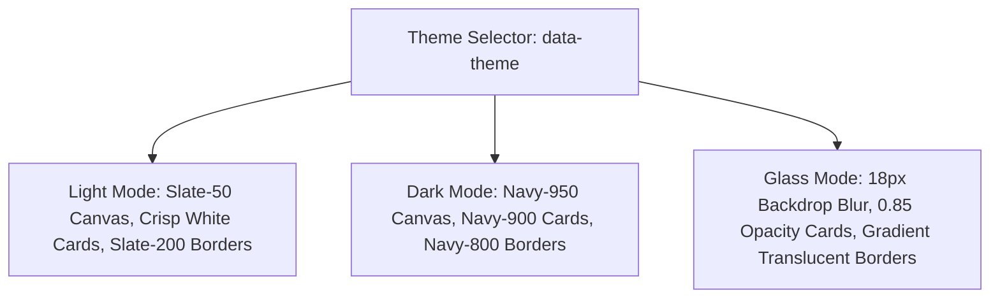

# CH ACADEMY DESIGN SYSTEM — ENTERPRISE SAAS SPECIFICATION

> **Version:** 2.4.0 (Enterprise Edition)  
> **Brand Identity:** CH Academy (Vietnamese EdTech Platform)  
> **Target Audience:** Administrators, Instructors, Students, Academic Staff  
> **Status:** Active & Implemented  

---

## 1. Executive Summary & Brand Principles

The CH Academy Design System establishes an enterprise-grade visual and behavioral framework tailored for higher-education and advanced training management. 

### Core Design Pillars
1. **Brand Identity Preservation:**  
   Retains CH Academy's distinctive deep oceanic navy (`#0F243E`, `#142B4A`) and electric sky/cyan accents (`#0EA5E9`, `#38BDF8`), maintaining instant recognition and trust without adopting generic dark themes.
2. **Nexora Layout Paradigm Integration:**  
   Inspired by Nexora's high-efficiency analytical layout: 66/34 bi-column workspace ratio, high information density, integrated search and filtering bars, contextual operational alerts, and clear primary/secondary hierarchical grouping.
3. **Multi-Theme Coexistence (Tri-Surface Engine):**  
   Seamlessly supports **Light Mode**, **Dark Mode**, and **Glassmorphism Mode** using CSS variable tokens and scoped data attributes (`[data-theme="light"]`, `[data-theme="dark"]`, `[data-theme="glass"]`).
4. **Interactive 3D Depth & Micro-Interactions:**  
   Features hardware-accelerated 3D elevated hover states (`translateY(-2.5px)`) and rotating conic-gradient border glows (`GlowCard`) applied selectively to cards, metrics, and actionable widgets.

---

## 2. Color Tokens & Palette Architecture

### 2.1 Primary Brand Palette
| Token Name | Hex Code | HSL / RGB | Usage & Semantic Role |
|:---|:---|:---|:---|
| `--color-navy-950` | `#081220` | `rgb(8, 18, 32)` | Deepest background in dark mode, root container canvas |
| `--color-navy-900` | `#0F243E` | `rgb(15, 36, 62)` | Primary brand dark tone, sidebar background, dark cards |
| `--color-navy-800` | `#142B4A` | `rgb(20, 43, 74)` | Secondary dark tone, active nav items, borders in dark mode |
| `--color-navy-700` | `#1B3B65` | `rgb(27, 59, 101)` | Hover states for dark cards and elevated panels |
| `--color-primary-600` | `#0284C7` | `rgb(2, 132, 199)` | Primary actionable button states, high-contrast links |
| `--color-primary-500` | `#0EA5E9` | `rgb(14, 165, 233)` | Core cyan accent, badges, active indicators, chart gradients |
| `--color-primary-400` | `#38BDF8` | `rgb(56, 189, 248)` | Glow borders, secondary highlights, subtle glowing accents |
| `--color-blue-600` | `#2563EB` | `rgb(37, 99, 235)` | Secondary action tone for academic actions |

### 2.2 Semantic Feedback Palette
| Intent | Background Token | Border Token | Text Token | Badge Class |
|:---|:---|:---|:---|:---|
| **Success / Active** | `rgba(16, 185, 129, 0.12)` | `rgba(16, 185, 129, 0.3)` | `#10B981` (`emerald-500`) | `badge-success` |
| **Warning / Attention** | `rgba(245, 158, 11, 0.12)` | `rgba(245, 158, 11, 0.3)` | `#F59E0B` (`amber-500`) | `badge-warning` |
| **Danger / Urgent** | `rgba(239, 68, 68, 0.12)` | `rgba(239, 68, 68, 0.3)` | `#EF4444` (`rose-500`) | `badge-danger` |
| **Info / Scheduled** | `rgba(14, 165, 233, 0.12)` | `rgba(14, 165, 233, 0.3)` | `#0EA5E9` (`sky-500`) | `badge-info` |
| **Neutral / Draft** | `rgba(148, 163, 184, 0.12)`| `rgba(148, 163, 184, 0.25)`| `#94A3B8` (`slate-400`) | `badge-neutral` |

### 2.3 Surface Modes Matrix


---

## 3. Typography Hierarchy (Inter Scale)

Font family: `'Inter', -apple-system, BlinkMacSystemFont, 'Segoe UI', Roboto, sans-serif`.

| Role / Utility Class | Font Size | Line Height | Weight | Letter Spacing | CSS Utility Reference |
|:---|:---:|:---:|:---:|:---:|:---|
| **Page Title** (`.typo-page-title`) | 24px (`1.5rem`) | 32px (`2rem`) | 700 (Bold) | `-0.025em` | `text-2xl font-bold tracking-tight` |
| **Section Title** (`.typo-section-title`) | 16px (`1.0rem`) | 24px (`1.5rem`) | 600 (Semibold) | `-0.015em` | `text-base font-semibold tracking-tight` |
| **KPI Primary Value** (`.typo-kpi-value`) | 26px (`1.625rem`)| 32px (`2rem`) | 700 (Bold) | `-0.03em` | `text-[26px] font-bold tracking-tight` |
| **KPI Secondary Value** | 22px (`1.375rem`)| 28px (`1.75rem`)| 600 (Semibold) | `-0.02em` | `text-[22px] font-semibold` |
| **Body Standard** (`.typo-body`) | 14px (`0.875rem`)| 20px (`1.25rem`)| 400 (Regular) | `normal` | `text-sm font-normal` |
| **Table Data / Dense** (`.typo-table`)| 13px (`0.8125rem`)| 18px (`1.125rem`)| 400 / 500 | `normal` | `text-[13px] font-normal` |
| **Secondary Label / Micro** (`.typo-label-secondary`)| 11.5px (`0.72rem`)| 16px (`1.0rem`) | 500 (Medium) | `+0.01em` | `text-[11.5px] uppercase tracking-wide`|
| **Navigation Link** (`.typo-nav-item`) | 13.5px (`0.84rem`)| 20px (`1.25rem`)| 500 (Medium) | `normal` | `text-[13.5px] font-medium` |
| **Action Button** (`.typo-btn`) | 13px (`0.8125rem`)| 18px (`1.125rem`)| 600 (Semibold) | `-0.01em` | `text-[13px] font-semibold` |

---

## 4. Spacing, Elevation & Corner Radii

### 4.1 Spacing Scale
- Base unit: `4px` (`0.25rem`)
- Standard card padding: `p-4` (mobile/compact) to `p-5` or `p-6` (standard desktop).
- Section gaps: `gap-4` (16px) for compact metric grids; `gap-6` (24px) for major layout columns.
- Page margins: `px-4 sm:px-6 lg:px-8 py-6` to prevent edges touching viewport borders.

### 4.2 Corner Radii
- Standard Cards & Containers: `rounded-xl` (`12px` or `0.75rem`)
- Large Containers & Modals: `rounded-2xl` (`16px` or `1rem`)
- Buttons & Input Fields: `rounded-lg` (`8px` or `0.5rem`)
- Badges & Status Pills: `rounded-full` (`9999px`)

### 4.3 Elevation & Shadows
- **Card Default:** `shadow-sm` (`0 1px 2px 0 rgba(0, 0, 0, 0.05)`)
- **Card Elevated / Hovered:** `shadow-lg` (`0 10px 15px -3px rgba(0, 0, 0, 0.1), 0 4px 6px -4px rgba(0, 0, 0, 0.1)`)
- **3D Animated Glow Shadow:** `0 12px 28px -6px rgba(14, 165, 233, 0.18)`

---

## 5. GlowCard Component API Specification

The `GlowCard` component provides an enterprise-grade 3D hover lift and rotating conic-gradient beam.

```tsx
interface GlowCardProps extends React.HTMLAttributes<HTMLDivElement> {
  children: React.ReactNode;
  className?: string;
  glowColor?: 'primary' | 'sky' | 'emerald' | 'amber' | 'rose' | 'purple';
  intensity?: 'subtle' | 'medium' | 'strong';
  active?: boolean;
  interactive?: boolean;
  animatedBeam?: boolean;
  onClick?: () => void;
}
```

### Key Technical Characteristics:
- **GPU Acceleration:** `will-change: transform`, `transform: translateZ(0)`
- **Lift Transition:** `transform: translateY(-2.5px)` upon hover.
- **Accessibility:** Automatically checks `prefers-reduced-motion` media queries; disables infinite gradient rotation when users have motion sensitivity enabled.
- **Full Keyboard Navigation:** Accessible via `tabIndex={0}`, triggers with `Enter` or `Space`, with visible focus ring (`focus-visible:ring-2 focus-visible:ring-sky-500`).

---

## 6. Implementation Verification
- Design system rules and typography utility classes: [`frontend/src/index.css`](file:///e:/CA_NHAN_CV/CH_Academy/frontend/src/index.css)
- Reusable Card component: [`frontend/src/components/ui/GlowCard.tsx`](file:///e:/CA_NHAN_CV/CH_Academy/frontend/src/components/ui/GlowCard.tsx)
- Reusable Stat Card: [`frontend/src/components/ui/StatCard.tsx`](file:///e:/CA_NHAN_CV/CH_Academy/frontend/src/components/ui/StatCard.tsx)
- Vector Chart Visuals: [`frontend/src/components/ui/DashboardCharts.tsx`](file:///e:/CA_NHAN_CV/CH_Academy/frontend/src/components/ui/DashboardCharts.tsx)

