# CH ACADEMY — THIẾT KẾ SIDEBAR TINH GỌN (SIDEBAR COMPACT REDESIGN)

## 1. Bối cảnh & Vấn đề Cần Giải Quyết

Trước khi tối ưu, Sidebar của Admin Portal (`frontend/src/layouts/AdminLayout.tsx`) gặp phải các bất cập:
1. **Độ rộng chiếm dụng quá nhiều diện tích màn hình:** Đạt tới 280px, làm thu hẹp không gian bảng biểu và đồ thị phân tích trên các laptop phổ biến (độ phân giải 1366x768 hoặc 1440x900).
2. **Chiều cao menu quá dài, gây cuộn chuột liên tục:** Menu bị chia vụn thành 6 nhóm rời rạc, mỗi menu item cao từ 44px đến 48px kèm các huy hiệu đếm số lượng gây nhiễu thị giác.
3. **Phân nhóm chưa hợp lý:** Các tính năng có liên hệ mật thiết (ví dụ Khóa học và Lớp học; Đề thi và Chấm bài; Tài chính và Cấu hình) bị phân tán.

---

## 2. Thông số Tối ưu Kích thước và Tỷ lệ

| Tiêu chí | Trước tối ưu | Sau tối ưu (Enterprise Standard) | Ghi chú kỹ thuật |
| :--- | :--- | :--- | :--- |
| **Chiều rộng mở rộng (Expanded Width)** | 280px | **240px** (`w-[240px]`) | Tiết kiệm 40px chiều ngang cho khu vực nội dung chính |
| **Chiều rộng thu gọn (Collapsed Width)** | 80px | **64px** (`w-16`) | Gọn gàng khi cần tối đa không gian làm việc |
| **Chiều cao Menu Item** | 44px - 48px | **36px** (`h-9 py-2 px-2.5`) | Giảm 20% chiều cao mỗi dòng, loại bỏ cuộn màn hình |
| **Khoảng cách giữa các Item (Item Gap)** | 8px | **3px - 4px** (`space-y-0.5`) | Tăng mật độ thông tin mà vẫn đảm bảo target touch/click |
| **Kích thước Icon** | 20px - 22px | **16px** (`size={16}`) | Tinh tế, sắc nét, không lấn át nhãn chức năng |
| **Kích thước Font Chữ Nhãn** | 14px Semibold | **12.5px Medium** (`text-[12.5px] font-medium`) | Đúng quy chuẩn SaaS quốc tế |
| **Tiêu đề Phân nhóm (Group Header)** | 12px Bold kèm Badge đếm | **10.5px Semibold Upper** (`text-[10.5px] tracking-wider`) | Đã lược bỏ toàn bộ badge số đếm gây nhiễu |
| **Chiều cao Header & Footer Sidebar** | 72px / 64px | **56px (h-14) / 48px (h-12)** | Cân bằng hoàn hảo với Topbar |

---

## 3. Tái cấu trúc 4 Nhóm Chức năng Logic (Consolidated Groups)

Toàn bộ 18 tuyến đường (routes) quản trị đã được hợp nhất từ 6 nhóm cũ vào **4 nhóm chức năng nghiệp vụ chặt chẽ**:

```mermaid
graph TD
    A[Admin Sidebar - 240px] --> B[1. ĐIỀU HÀNH & ĐÀO TẠO]
    A --> C[2. KIỂM TRA & ĐÁNH GIÁ]
    A --> D[3. HỌC VIÊN & TUYỂN SINH]
    A --> E[4. HỆ THỐNG & TÀI CHÍNH]

    B --> B1[Tổng quan Dashboard]
    B --> B2[Khóa học & Lộ trình]
    B --> B3[Lớp học & Điểm danh]
    B --> B4[Phân công Giảng dạy]
    B --> B5[Thời khóa biểu & Lịch học]

    C --> C1[Ngân hàng Câu hỏi]
    C --> C2[Đề thi & Khảo thí]
    C --> C3[Duyệt đề thi BQT]
    C --> C4[Chấm bài & Điểm số]
    C --> C5[Phòng thi Online]
    C --> C6[Báo cáo Phân tích Điểm]

    D --> D1[Hồ sơ Học sinh]
    D --> D2[CRM & Tuyển sinh]
    D --> D3[Điểm danh Toàn trường]

    E --> E1[Kế toán & Học phí]
    E --> E2[Trung tâm Bảo mật]
    E --> E3[Nhật ký Kiểm toán Audit]
    E --> E4[Cấu hình Học vụ]
```

### Chi tiết các tuyến đường được bảo tồn 100%:
1. **ĐIỀU HÀNH & ĐÀO TẠO:**
   - `/admin/dashboard` — Tổng quan Dashboard
   - `/admin/courses` — Khóa học & Lộ trình
   - `/admin/classes` — Lớp học & Điểm danh
   - `/admin/teacher-assignments` — Phân công Giảng dạy
   - `/admin/attendance` — Thời khóa biểu & Lịch học
2. **KIỂM TRA & ĐÁNH GIÁ:**
   - `/admin/question-bank` — Ngân hàng Câu hỏi
   - `/admin/exams` — Đề thi & Khảo thí
   - `/admin/exam-approval` — Duyệt đề thi BQT
   - `/admin/grading` — Chấm bài & Điểm số
   - `/admin/exam-room` — Phòng thi Online
   - `/admin/exam-analytics` — Báo cáo Phân tích Điểm
3. **HỌC VIÊN & TUYỂN SINH:**
   - `/admin/students` — Hồ sơ Học sinh
   - `/admin/leads` — CRM & Tuyển sinh
   - `/admin/attendance-monitoring` — Điểm danh Toàn trường
4. **HỆ THỐNG & TÀI CHÍNH:**
   - `/admin/finance` — Kế toán & Học phí
   - `/admin/security` — Trung tâm Bảo mật
   - `/admin/audit-logs` — Nhật ký Kiểm toán Audit
   - `/admin/settings` — Cấu hình Học vụ

---

## 4. Chế độ Thu gọn (Collapsed Mode) & Tooltip

- Khi người dùng thu gọn sidebar (qua nút mũi tên chân trang hoặc phím tắt), bề rộng chuyển mượt mà về `w-16` (64px) với hiệu ứng transition CSS thời gian 200ms.
- Nhãn nhóm và tên menu tự động ẩn.
- Các icon 16px được căn giữa hoàn hảo.
- Khi rê chuột vào icon, tooltip hiển thị tên chức năng sắc nét với font 11.5px, vị trí bên phải cố định (`fixed left-16`), không bị che khuất bởi z-index của các thành phần nội dung.

